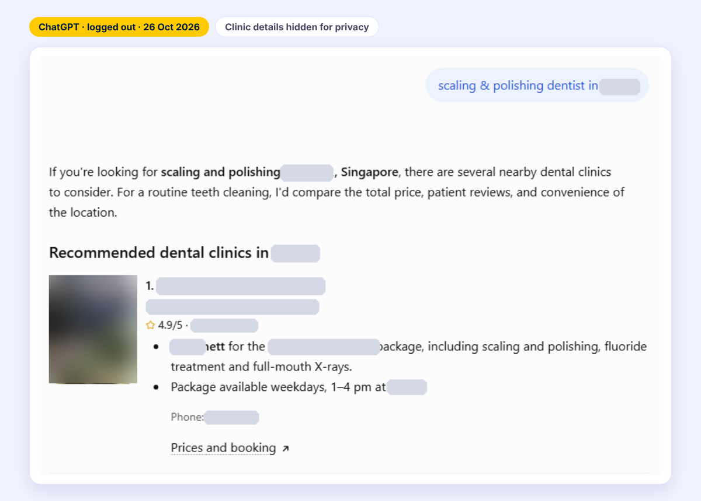
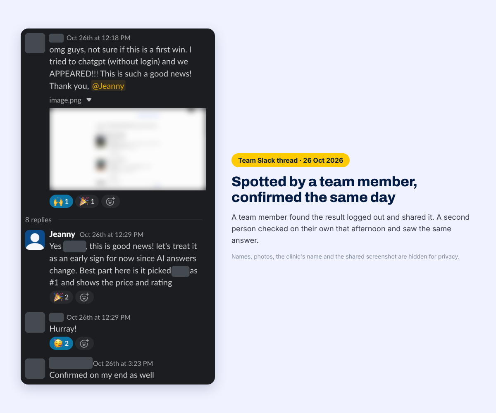

## The AI result

On 26 October 2026, a team member asked ChatGPT, without logging in, for a scaling and polishing dentist in the clinic's neighbourhood. ChatGPT listed the clinic first.

The answer didn't just name the clinic. It pulled the details a patient needs to decide:

- The **package price** and what it includes: scaling and polishing, fluoride treatment and full-mouth X-rays
- The **hours** the package is available
- The clinic's **rating**
- A direct link to the clinic's **prices and booking** page

A second person checked on their own that afternoon and saw the same answer. Clinic details are hidden in the screenshot to keep the client anonymous.

## Why it matters

Getting named by an AI assistant is still rare for local businesses. The SOCi 2026 Local Visibility Index found that ChatGPT recommends only about 1.2% of local business locations. For a routine, high-intent search like scaling and polishing, being the first name in the answer puts the clinic in front of patients at the moment they're choosing where to book.

## What likely helped

AI answers don't come with a list of ranking factors, so this is an informed read, not a guarantee:

- **Clear, factual service information.** The clinic's prices page states the package price, what's included and when it's available, and those are the details ChatGPT pulled into its answer.
- **Strong reviews.** ChatGPT showed the clinic's rating right under its name.
- **A site organised around patient questions.** The six topic clusters gave search engines and AI tools a clear picture of what the clinic offers.

## What's next

AI answers change from week to week. We're treating this as an early sign and tracking the same set of questions every month to see whether it holds, and whether the clinic gets named for other services too. I explain the method in [how to track AI search traffic](/blog/how-to-track-ai-search-traffic/).
