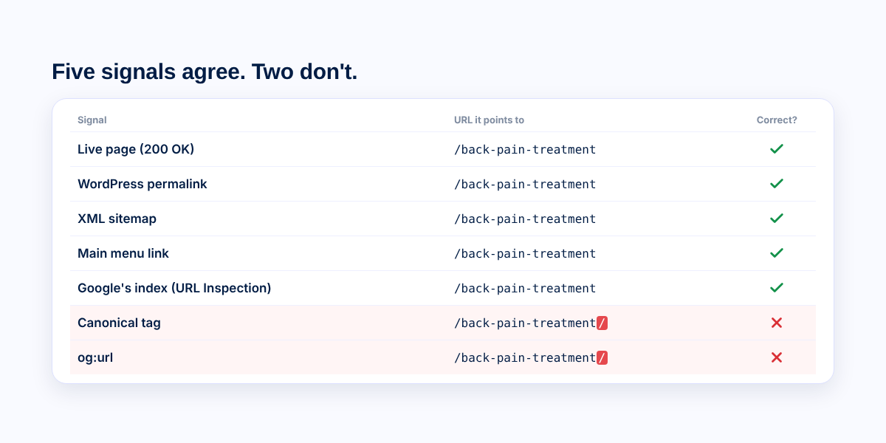
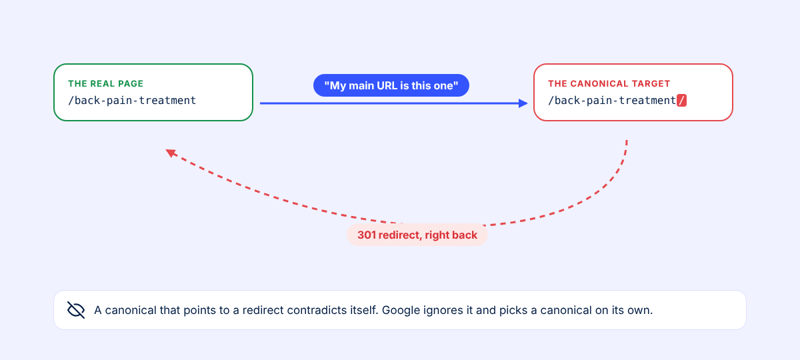
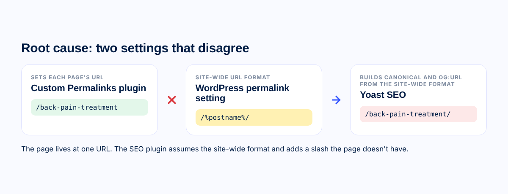
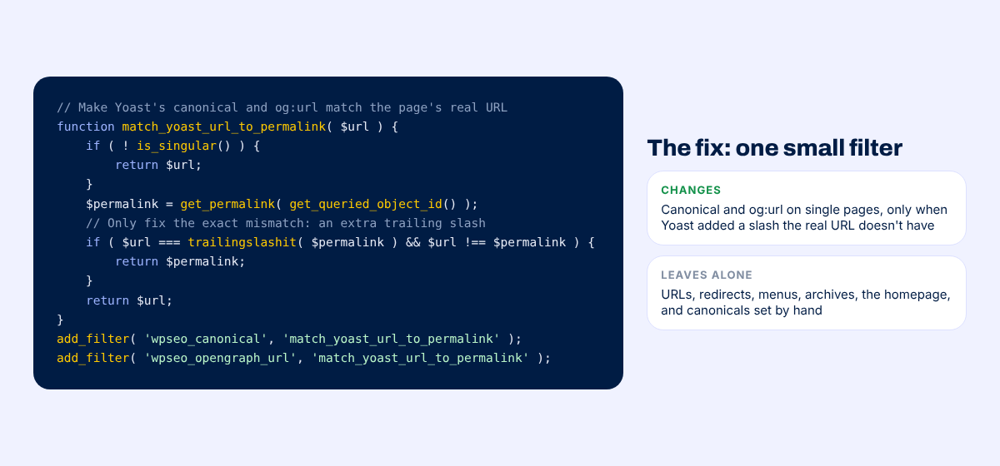
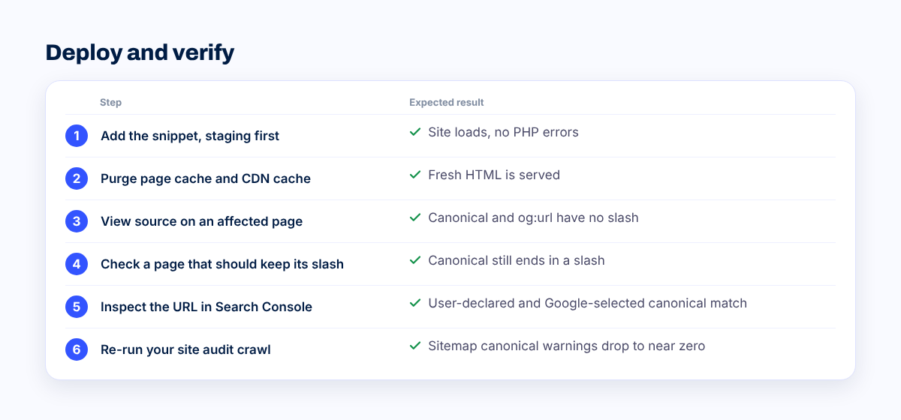

If your canonical tag points to a redirect, Google ignores it and has to guess which URL is the real page. On WordPress, the usual cause is a trailing slash: the SEO plugin adds one to the canonical that the live URL doesn't have, and a small filter that makes Yoast use each page's real URL fixes it.

I ran into this on a client audit recently. Semrush flagged about two-thirds of the site's sitemap URLs as "Incorrect pages found in sitemap.xml." Nothing was visibly broken. Pages loaded, Google indexed them, and rankings looked normal. Here's how to spot it, why it happens, and how to fix it safely.

## The symptoms: how this issue shows up

You'll usually notice it in an audit tool first. Depending on the tool, it shows up as:

- **Semrush:** "Incorrect pages found in sitemap.xml"
- **Screaming Frog:** pages listed as **Canonicalised** in the Canonicals tab, where the canonical differs from the URL
- **Ahrefs Site Audit:** "Canonical points to redirect"
- **Google Search Console:** in URL Inspection, the **user-declared canonical** and the **Google-selected canonical** don't match

If you see any of these across many pages at once, a site-wide setting is the likely cause, not a one-off mistake.

## What's wrong: five signals agree, two don't

On every affected page, the live URL had no trailing slash. For example, `/back-pain-treatment`. Every signal on the site pointed to that URL, except the ones the SEO plugin produced.



When I viewed the page source, the problem was right there:

```html
<link rel="canonical" href="https://example.com/back-pain-treatment/" />
<meta property="og:url" content="https://example.com/back-pain-treatment/" />
```

And when you request the slash version, the server sends a 301 redirect straight back to `/back-pain-treatment`.

> **Quick check:** In the page source, search for `oembed`. WordPress adds an oEmbed link with the page's real permalink. If that URL has no slash but your canonical does, you've found this issue.

## Why it matters

The canonical tag is supposed to name the final, live version of a page. Here it named a URL that only redirects back to the page itself.



That causes three problems:

1. **Google ignores the canonical.** A canonical that points to a redirect contradicts itself, so Google picks a canonical on its own. In this case Google chose the right URL, but only because every other signal agreed. You're relying on Google to clean up after you.
2. **Every page sends a mixed signal.** The sitemap says one URL and the canonical says another, on every affected page. Audit tools flag it, and Google spends crawl time checking both versions.
3. **AI tools and other crawlers may record the wrong URL.** Many tools trust the canonical tag as the source of truth. They may store or cite the slash version, which then has to redirect.

## The root cause: two settings that disagree

Three pieces of the WordPress setup were involved.



- **Custom Permalinks** gave individual pages URLs without a trailing slash, and redirected the slash version to them.
- **WordPress's site-wide permalink structure** ended in a slash, like `/%postname%/`.
- **Yoast SEO** built the canonical, og:url and schema URLs using the site-wide format, so it added a slash that these pages didn't have.

Pages whose real URL already ended in a slash were fine. Only pages with custom slash-free URLs were affected, which is why it hit most of the site but not all of it.

This pattern isn't limited to Custom Permalinks. Any setup where individual URLs don't follow the site-wide format can cause the same mismatch. That includes imported pages from an old site, a migration from another platform, or hand-edited redirects.

## The fix: make Yoast use each page's real URL

The safest fix leaves every URL, redirect and menu exactly as it is. It changes only what Yoast prints in the canonical and og:url tags, and only when Yoast has added a slash the real URL doesn't have.



Add this to your child theme's `functions.php`, or as a snippet in a plugin like WPCode:

```php
// Make Yoast's canonical and og:url match the page's real URL
function match_yoast_url_to_permalink( $url ) {
    if ( ! is_singular() ) {
        return $url;
    }
    $permalink = get_permalink( get_queried_object_id() );
    // Only fix the exact mismatch: Yoast added a trailing slash the real URL doesn't have
    if ( $url === trailingslashit( $permalink ) && $url !== $permalink ) {
        return $permalink;
    }
    return $url;
}
add_filter( 'wpseo_canonical', 'match_yoast_url_to_permalink' );
add_filter( 'wpseo_opengraph_url', 'match_yoast_url_to_permalink' );
```

Here's what it does, line by line:

- It only runs on single pages and posts. Archives, categories and the homepage are left alone.
- It gets the page's real permalink from WordPress, which already respects Custom Permalinks.
- It only changes the URL when Yoast's version is the real URL plus an extra slash. If you've typed a custom canonical into Yoast by hand, or the real URL already ends in a slash, nothing changes.

If you use Rank Math instead of Yoast, the same idea works with its `rank_math/frontend/canonical` filter.

### What not to do

It's tempting to fix this by changing settings. Don't. Each of these creates bigger problems than it solves:

- **Don't change the WordPress permalink structure or page slugs.** That changes live URLs across the site.
- **Don't add new redirect rules** in a redirect plugin or `.htaccess`. The existing redirects are correct.
- **Don't edit menu links or deactivate Custom Permalinks.** Both would change URLs that Google already indexes.

## Deploy and verify

Test on staging first if you have it. The whole process takes about 15 minutes.



1. **Add the snippet**, then load a few pages to confirm there are no PHP errors.
2. **Purge every cache:** your caching plugin, your host's server cache, and your CDN, such as Cloudflare. Otherwise you'll keep seeing the old HTML.
3. **View source on an affected page** in an incognito window. The canonical and og:url should match the live URL, with no slash.
4. **Repeat on two or three more pages,** including a blog post.
5. **Check a page that should keep its slash.** Its canonical should still end in a slash. This confirms the filter isn't overreaching.
6. **Inspect the URL in Search Console** and click Request Indexing on your key pages. Then re-run your audit crawl.

**What success looks like:** within about a week, URL Inspection shows the same URL for the user-declared and Google-selected canonical. The "Incorrect pages found in sitemap.xml" warning drops to near zero on the next crawl.

**To roll back:** remove or deactivate the snippet and purge the cache. Nothing else changed, so the site returns to how it was.

## Two follow-ups worth doing

These aren't required for the fix, but I flag them on every audit like this.

- **Schema URLs may still carry the slash.** Yoast's `WebPage` schema uses the same site-wide format for its `@id` and `url`. Google doesn't use these as a canonical signal, so it's low priority. You can align them later with Yoast's schema filters.
- **Remove any inactive second SEO plugin.** On this site, a second SEO plugin was installed but switched off. If someone turns it on by accident, the site would output two sets of titles, canonicals and schema. Delete plugins you don't use.

## The bigger lesson: one URL, everywhere

Trailing slash or no trailing slash doesn't matter much on its own. What matters is that each page has one URL, and every signal uses it: the canonical tag, sitemap, menus, internal links, redirects and schema. When those agree, Google doesn't have to guess.

If you're seeing canonical warnings in your audit tool and aren't sure where they come from, this is one of the checks in my [technical SEO audit checklist](/blog/technical-seo-audit-checklist/). Or [book a free call](/contact/), send me your audit export, and I'll tell you what's causing it. Fixes like this are part of my [technical SEO service](/services/technical-seo/).
