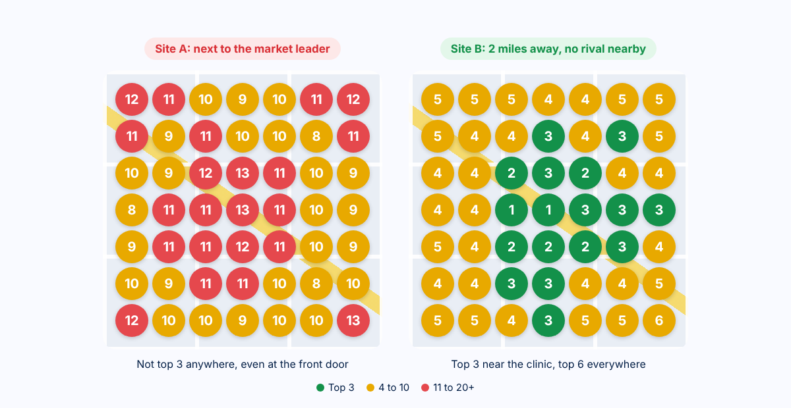
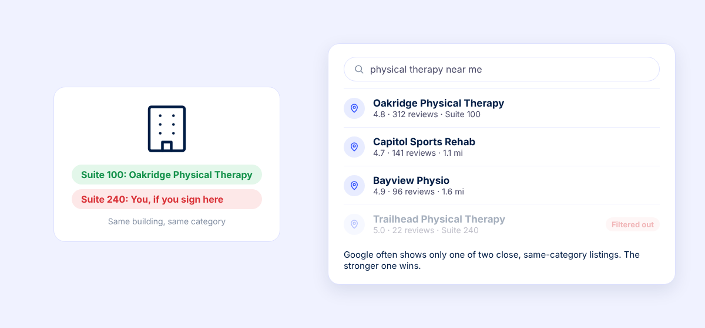
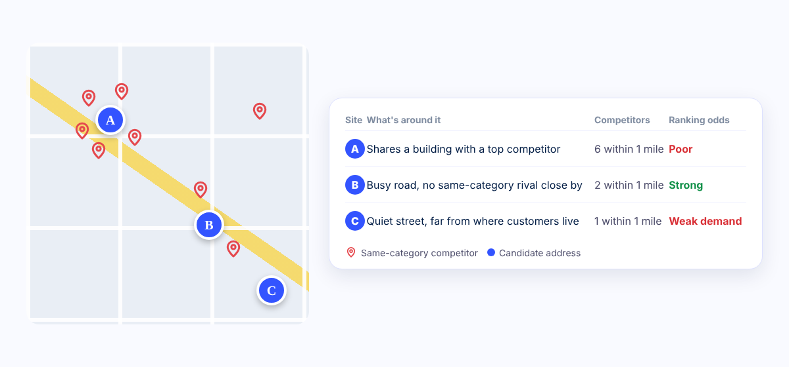
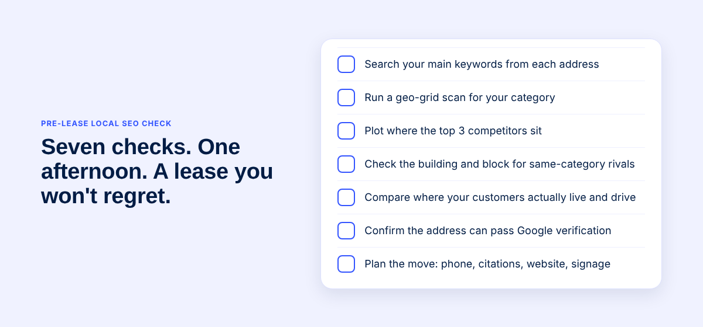

A lease is a five- or ten-year decision. Most business owners look at rent, parking, foot traffic and signage before they sign. Very few look at the one thing that decides where they'll show up on Google Maps: who else is already ranking near that address.

I've seen it go wrong. A clinic moves into a nicer building and its map rankings disappear, because a bigger clinic in the same category already sits two floors up. That's a hard problem to fix once the lease is signed.

The good news is you can check all of this in an afternoon. This guide walks through why your address matters so much, what Google's local filter does, and a seven-step check to run before you commit. I'll use a made-up physical therapy clinic, Trailhead Physical Therapy, to show each step.

## Why your address matters more than almost anything else

Google ranks local results on three things: **relevance**, **distance** and **prominence**. Relevance is how well your profile matches the search. Prominence is how well known you are, which comes from reviews, links and mentions. Distance is how close your business is to the person searching.

You can improve relevance and prominence every month. Distance is fixed the day you sign. It sets the area where you have a fair shot at the top three. Move a mile in the wrong direction, and you may spend years and a lot of money trying to rank in a neighbourhood that's now out of reach.

The image above shows what that looks like. Each dot is a point on the map, and the number is where a business ranks when someone searches from that spot. Same business, same reviews, two different addresses. The results are worlds apart.

## The local filter: why a competitor next door can hide you

Here's the part that catches people off guard. Google doesn't want to show the same kind of business twice in one small area. When two listings in the same category sit at the same address or very close together, Google often shows the stronger one and filters out the other.

The SEO community calls this the **Possum filter**, after the 2016 update that made it obvious. It's still very much active. It affects:

- Two businesses in the same category in the same building, even with different suite numbers.
- Businesses very close together on the same street.
- Practitioners who share an office, like lawyers or doctors with individual listings at one practice address.

The filter isn't a penalty. Your listing still exists, and you can still rank for searches where you're clearly the best match. But for the broad searches that bring most calls, like "physical therapy near me," the stronger neighbour usually wins and you disappear.

So if your dream space is in the same building as the established leader in your category, that's a red flag. Not a dealbreaker every time, but a serious one.

## How to check a location before you sign: 7 steps

### 1. List your candidate addresses

Write down every address you're seriously considering. Two or three is ideal. Add the exact suite number and note the business category you'll use on your Google Business Profile, since the filter works by category.

### 2. Search your main keywords from each address

Go to each address, or near it, and search your top keywords on your phone. For Trailhead, that's "physical therapy near me," "physical therapist [city]," and "sports injury physio." Note the top three businesses in the map pack each time.

Doing this on site gives you real results from that spot. If you can't visit, change your location in Google's search settings, but treat that as a rough guide.

### 3. Run a geo-grid scan for your category

A single search shows one point. A geo-grid scan shows the whole area. Tools like **Local Falcon**, **BrightLocal's Local Search Grid** and **Local Viking** search your keyword from a grid of points around an address, then show who ranks where.

The key trick: you don't need to be open yet to run one. Scan the **top competitors** around each candidate address. You'll see how strong they are, how far their reach goes, and where the gaps are. Most of these tools charge per scan, so a pre-lease check usually costs very little.

### 4. Plot where the top competitors sit

Take the businesses that rank top three across your scans and put them on a map. Look at three things:

- **Distance** from each candidate address
- **Review count and rating**, which hints at how hard they are to beat
- **Category**, since only same-category competitors trigger the filter

A site surrounded by strong same-category competitors will be an uphill climb. A site with demand nearby but no dominant rival right next door is the sweet spot.

### 5. Check the building and the block

Walk the building directory and the surrounding block. Look for businesses in your exact category, including ones that might not rank well right now. A weak competitor today can become a strong one, and if they're in your building, the filter can work against you later.

Also check Google Maps for the building's address. Some businesses have listings there even if they don't have signage out front.

### 6. Compare where your customers actually live

Ranking near your front door only helps if customers search from there. Look at where your current customers come from. For a new business, think about who you serve and where they live, work and drive. A cheap space on a quiet street far from your customers can rank well and still bring in few calls.

### 7. Confirm the address can pass Google verification

Google requires a real, staffed location where you meet customers, or a service-area setup if you go to them. Virtual offices, mailbox addresses and coworking desks without permanent signage often fail verification or get suspended later. Ask the landlord about signage and make sure you'll have a clear, permanent presence before you sign.

## If you're moving an existing location

Moving is riskier than opening fresh, because you have rankings and reviews to protect. A few things make the transition smoother:

- **Update your Google Business Profile address, don't create a new profile.** Your reviews stay with the listing. Expect Google to ask for verification at the new address.
- **Keep the same phone number.** It's the thread that ties your history to your new location.
- **Update your website the same day.** Footer, contact page, location page and schema should all show the new address.
- **Update your citations within a week or two.** Start with the big platforms, then work down. My [NAP consistency playbook](/blog/nap-consistency-local-seo/) has the full list.
- **Expect some movement.** Your rankings will shift to the new area. Customers near the old address may see you less. Plan for a few weeks of lower visibility and keep your review requests going.

## When the numbers say the space isn't right

Sometimes the check tells you what you didn't want to hear. The perfect space has a strong competitor upstairs. Here are your options:

- **Pick a different site** if you have one that scans well. This is the cleanest fix.
- **Negotiate a shorter lease** with an option to extend, so you're not locked in if rankings don't come.
- **Use a different primary category** only if it truly describes your business. A physio clinic that mostly does sports rehab might fit "sports medicine clinic." Never pick a category just to dodge the filter. That backfires.
- **Plan a bigger marketing budget** for the first year, through ads, referrals and partnerships, to make up for weaker map visibility.

A local SEO check won't decide your lease on its own. Rent, space and customers matter too. But it adds the piece most people skip, and it's much cheaper to look now than to fix it later.

If you're comparing locations and want a second set of eyes, I run pre-lease ranking checks as part of my [local SEO service](/services/local-seo/). [Book a free call](/contact/) and send me your shortlist.
