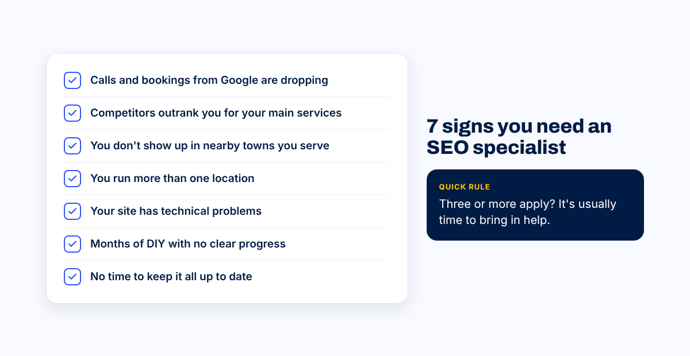
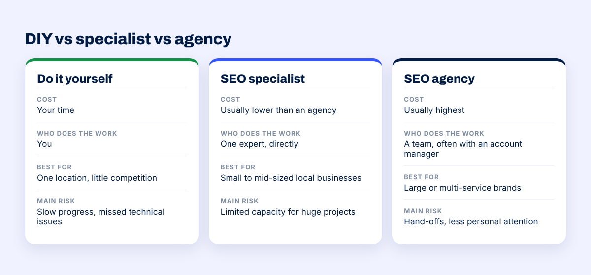
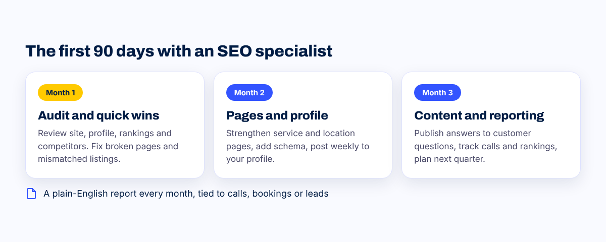
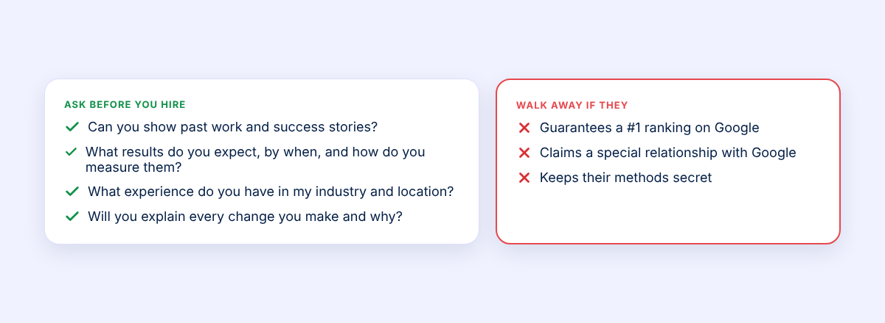

You don't always need an SEO specialist for your local business. If you have few competitors, one location and a few spare hours a week, you can handle the basics yourself, but hiring usually pays off once competitors outrank you, calls drop or you run several locations.

It comes down to your competition, your time and how complex your website is. Below you'll find when DIY works, the signs it's time to hire, what SEO costs and how to choose the right person.

## The short answer: it depends on three things

Google itself says that if you run a small local business, [you can probably do much of the work yourself](https://developers.google.com/search/docs/fundamentals/do-i-need-seo). Three things decide whether that holds for you:

1. **Competition.** How many businesses fight for the same searches in your area?
2. **Time.** Can you spend a few hours every week learning, fixing and updating?
3. **Complexity.** Do you run one simple site, or several locations and dozens of pages?

Low competition, spare time and a simple site point to DIY. If two or three of those go the other way, hiring usually pays off.

## When you can do local SEO yourself

You can likely handle SEO yourself if your town has only a few competitors, you have one location and you can set aside a few hours each week. Start with the free basics:

- **Complete your Google Business Profile.** Fill in every field, pick the right categories, add photos and post updates.
- **Build one clear page per service.** Say what you do, where you do it and what it costs.
- **Set up Google Search Console.** It shows which searches find your site and flags problems.
- **Match your business details everywhere.** Use the same name, address and phone on every listing. Here's [why NAP consistency matters for local rankings](/blog/nap-consistency-local-seo/).
- **Answer real customer questions.** Pages that answer what people ask before they call bring in more calls. This guide shows [how to build pages that answer customer questions](/blog/how-to-get-more-calls-from-google-business-profile/).

Google's free [SEO Starter Guide](https://developers.google.com/search/docs/fundamentals/seo-starter-guide) covers the rest of the basics.

## 7 signs your business needs an SEO specialist

You likely need an SEO specialist when search is costing you customers and you don't have the time or skills to fix it. Watch for these signs:

1. **Calls and bookings from Google are dropping,** even though your service hasn't changed.
2. **Competitors outrank you** in the map pack or search results for your main services.
3. **You don't show up in nearby towns** you serve, only close to your office.
4. **You run more than one location,** and each one needs its own page and Business Profile.
5. **Your website has technical problems,** like pages missing from Google, slow loading or duplicate content.
6. **You've tried DIY for months** with no clear progress.
7. **You don't have time** to keep your profile, pages and content up to date every week.

If three or more of these apply, it's usually time to bring in help.

## How much does SEO cost for a small business?

Local SEO commonly costs [$500 to $3,000 a month](https://www.webfx.com/local--seo/pricing/), with some small businesses paying around $1,000. One-time audits cost less. In a survey of 250 US businesses, [43% paid $101 to $750 for an SEO audit](https://www.webfx.com/seo/pricing/how-much-does-seo-audit-cost/).

| Type of help | What you get | Typical cost |
|---|---|---|
| One-time audit | A review of your site and profile, plus a plan | A few hundred dollars |
| Monthly local SEO | Ongoing fixes, content, profile and reporting | $500 to $3,000 a month |
| Hourly consulting | Advice on a specific problem or plan | Varies by experience |

Price depends on your competition, the number of locations and how much content you need. Freelancers usually cost less than agencies. You can see [what an audit and consulting cost with me](/services/) on my Services page.

## Is SEO worth it for a small business?

SEO is worth it when people search for your service in your area and one new customer is worth more than you'd pay each month. Run a simple check:

- **Look up demand.** Search your main service plus your city. Ads, a map pack and competitor sites mean people search for it.
- **Do the math.** For example, if an average job earns you $400 and SEO costs $1,000 a month, three extra jobs a month cover it.
- **Think long term.** Unlike ads, you don't pay for each click. Rankings keep bringing in calls as long as you maintain them.

Results can show up early. For one client, fixing four gaps in the website and Business Profile [got 75% more searches finding a junk removal company](/results/junk-removal-google-business-profile/) in the first 30 days.

## SEO specialist vs agency vs doing it yourself

Each option fits a different business. A specialist gives you one expert who knows your account. An agency gives you a team. DIY costs only your time.

| | Do it yourself | SEO specialist | SEO agency |
|---|---|---|---|
| Cost | Your time | Usually lower than an agency | Usually highest |
| Who does the work | You | One expert, directly | A team, often with an account manager |
| Best for | One location, little competition | Small to mid-sized local businesses | Large or multi-service brands |
| Main risk | Slow progress, missed technical issues | Limited capacity for huge projects | Hand-offs and less personal attention |

If you want expert help without hand-offs, a specialist is usually the best fit for a local business.

## What an SEO specialist does in the first 90 days

A good SEO specialist spends the first 90 days finding what holds you back, fixing it and building on it.

Here's how the first three months usually run:

- **Month 1: audit and quick wins.** Review your site, Business Profile, rankings and competitors. Fix broken pages, missing details and mismatched listings.
- **Month 2: pages and profile.** Strengthen service and location pages, add schema markup and post to your Business Profile every week.
- **Month 3: content and reporting.** Publish content that answers customer questions, track calls and rankings, and plan the next quarter.

You should get a plain-English report each month that ties the work to calls, bookings or leads.

## How to choose the right SEO specialist

Choose someone who shows real results, explains every change and never promises a #1 spot. Google's own guide suggests asking these questions before you hire:

- Can you show past work and success stories?
- What results do you expect, by when, and how do you measure them?
- What experience do you have in my industry and location?
- Will you explain every change you make and why?

Walk away from anyone who guarantees a #1 ranking, claims a special relationship with Google or keeps their methods secret. Google is clear that no one can guarantee a #1 ranking.

## Not sure yet? Start with a free strategy call

If you're still on the fence, a short call settles it. I'll look at your Business Profile, your rankings and your competitors, and tell you honestly whether you can handle it yourself or need help. Either way, you'll leave with your three biggest opportunities. [Book your free strategy call](/contact/) today.
