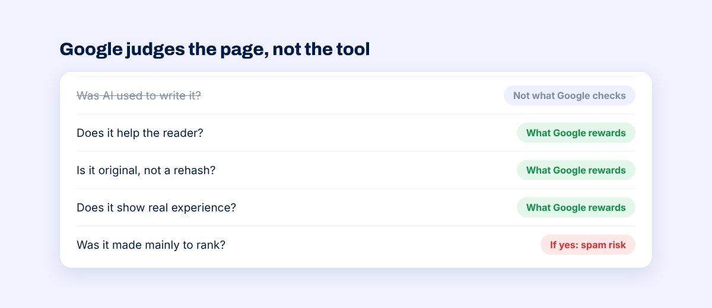
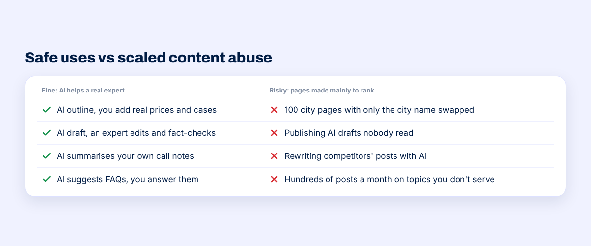
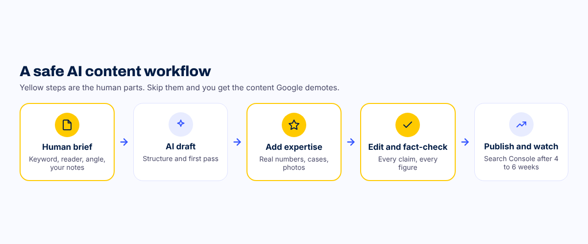
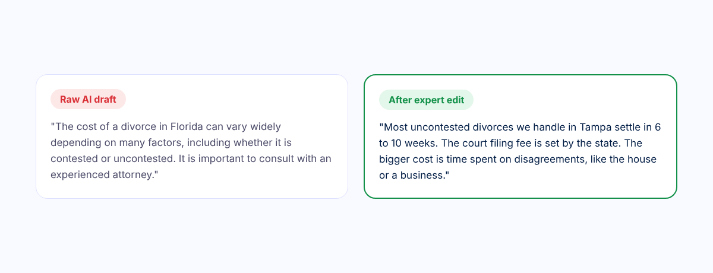

Yes, AI-generated content can rank on Google, because Google judges how helpful and original a page is, not whether AI helped write it. What Google penalizes is scaled content abuse: publishing many pages mainly to manipulate rankings, however they're made.

"Will Google penalize me for using ChatGPT to write my blog?" It's one of the most common content questions right now, and the advice out there is confusing. Here's what Google actually says, what gets sites in trouble, and a practical workflow for using AI on a small business website without risking your rankings. I'll use a made-up family law firm in Tampa as the example.

## The short answer: Google judges the page, not the tool

Google has been consistent on this since 2023. It rewards helpful, reliable content that's made for people, **however it's produced**. Using AI to help write a page isn't against its rules.

What Google cares about is the result:

- Does the page help the person who searched?
- Is it original, or a rehash of what's already out there?
- Does it show real experience or expertise?
- Was it made mainly to rank, rather than to help?

That last question is where the risk lives.

## What Google does penalize: scaled content abuse

In March 2024, Google added a spam policy called **scaled content abuse**. It covers generating many pages mainly to manipulate search rankings, with little or no value for users. The policy applies whether the pages are made by AI, by people, or by both.

Google's [spam policies](https://developers.google.com/search/docs/essentials/spam-policies) give examples, and they look familiar to anyone who's seen AI content mills:

- Hundreds of pages that only swap a city or keyword
- Content stitched together from other sites without adding value
- Mass-produced posts on topics the site has no real connection to

Google has kept enforcing this through its spam and core updates. Its guidance on using generative AI content says the same thing directly: using AI to produce many pages without adding value for users may break the scaled content abuse policy.

So the problem isn't AI. It's **scale without substance.** A small business that publishes four careful, expert-edited posts a month is nowhere near this line. A site that publishes 400 unedited AI posts a month probably is.

## Safe uses of AI vs risky ones

Here's how that plays out in practice:

**Generally fine:**

- AI drafts an outline, and you fill it with real prices, cases and advice
- AI writes a first draft, and an expert edits and fact-checks it
- AI summarizes your own notes, call recordings or FAQs into a readable post
- AI suggests questions people ask, and you answer them from experience

**Risky:**

- Pages for 100 suburbs where only the suburb name changes
- Publishing AI drafts that nobody read or checked
- Using AI to rewrite competitors' articles
- Hundreds of posts a month on topics you don't serve

The difference is always the same: is a real expert adding value, or is the tool doing all the work to fill pages?

## A safe AI content workflow for small businesses

This is the workflow I recommend. The AI handles the parts it's good at. You handle the parts only you can do.

### 1. Write a human brief

Before you open an AI tool, decide:

- **The main question** the page answers, and the keyword people use for it
- **Who the reader is** and what they need to decide
- **Your angle:** what you know about this that others don't
- **Your notes:** real numbers, examples, common mistakes, local rules

This takes 15 minutes and makes the biggest difference to the result. If you skip it, the AI fills the gaps with generic filler.

### 2. Let AI draft the structure

Give the AI your brief and ask for an outline and first draft. Ask it to answer the main question in the first two sentences and to use headings phrased the way people search.

### 3. Add your expertise

This is the step that makes the page worth ranking. Go through the draft and add:

- Real numbers from your own work, like timelines or price ranges
- Local detail that applies where you operate
- Specific examples (with client details removed)
- Your opinion: what you'd recommend, and why
- Original photos or diagrams if they help

Look at the difference above. The raw draft could appear on any law firm's site anywhere. The edited version could only come from a firm that handles these cases in Tampa. That's what Google calls helpful, and it's what AI tools look for when they choose sources to cite.

### 4. Edit and fact-check everything

AI tools make confident mistakes. They invent statistics, mix up laws between states, and cite sources that don't exist. Check every fact, figure and claim against a reliable source. For YMYL topics, meaning health, legal and financial content, have a qualified person review it before it goes live.

Then edit for voice. Cut filler phrases, shorten long sentences, and make it sound like your business, not a robot.

### 5. Publish, then watch the results

Add a clear author byline with real credentials. Publish, request indexing in Search Console, and check performance after four to six weeks. If the page gets impressions but few clicks, rework the title. If it gets no impressions, check whether it really answers a question people search. I cover this in [how to update old blog posts](/blog/how-to-update-old-blog-posts/).

## Signs your AI content needs more work

Before you publish, read the page and ask:

- Could this exact page appear on a competitor's site with only the name changed?
- Is there a single number, example or opinion that came from you?
- Does it repeat the same point in different words?
- Would you be comfortable if a client read it?

If the first answer is yes or the second is no, the page isn't ready.

## What this means for AI search too

The same rules apply when you want ChatGPT or Google's AI Overviews to cite you. AI tools can already summarize generic advice from a hundred sites. What they need are sources with specific, first-hand information they can't find anywhere else. Google's 2026 guide on AI features calls this "non-commodity" content.

So the good news is that you don't need two strategies. Content that's helpful enough to rank is the content AI tools want to cite. My guide to [building topical authority](/blog/how-to-build-topical-authority/) shows how to plan a set of pages like this around one topic.

If you'd like help setting up a content process that uses AI safely, that's part of my [content strategy service](/services/content-strategy/). Or [book a free call](/contact/) and we'll review a few of your existing posts together.
