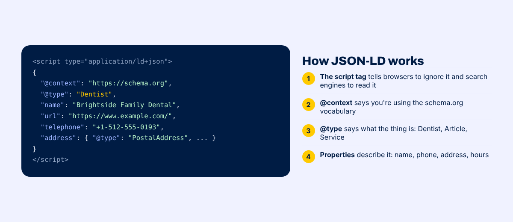
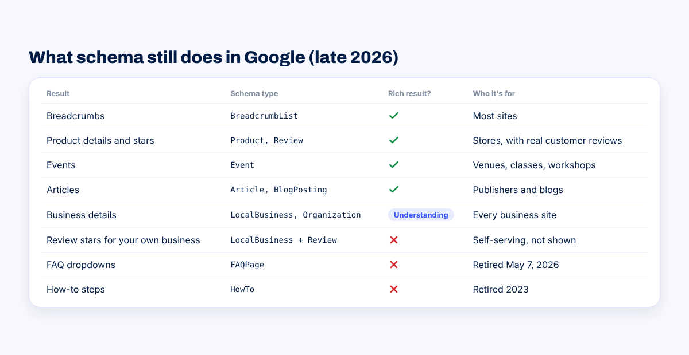
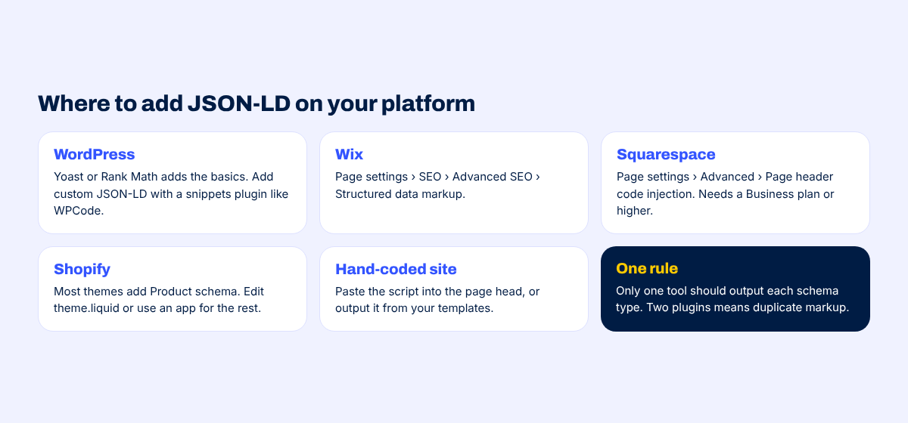
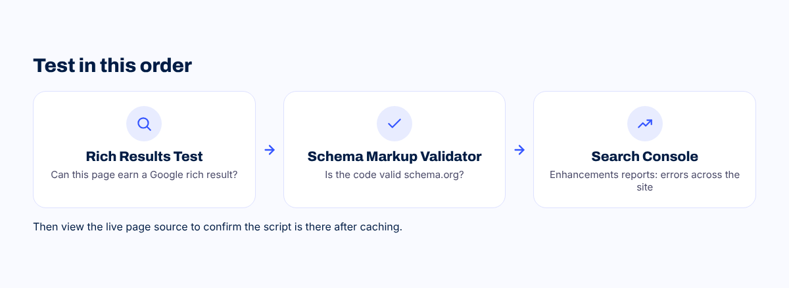
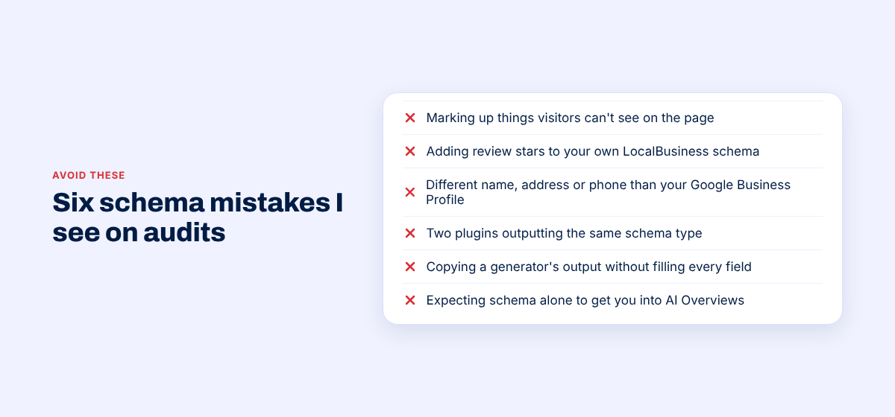

To add schema markup, paste a small JSON-LD script block with your business details into your page's code, then test it with Google's Rich Results Test. Most local business websites only need four or five of these blocks, and you can copy them from this guide.

Here's what schema still does in Google in 2026, which types to use, copy-ready JSON-LD examples, where to add them on your platform, and how to test them. I'll use a made-up practice, Brightside Family Dental in Austin, for the examples.

## What JSON-LD is and how it works

Schema markup is code that describes your page in a vocabulary search engines understand, from [schema.org](https://schema.org/). **JSON-LD** is the format Google recommends for writing it. It's a small script block that sits in your page's code. Visitors never see it, and it doesn't change your design.



Every JSON-LD block has the same parts:

1. **The script tag**, `<script type="application/ld+json">`, which tells browsers to ignore it and search engines to read it.
2. **`@context`**, which says you're using the schema.org vocabulary.
3. **`@type`**, which says what the thing is: a `Dentist`, an `Article`, a `Service`.
4. **Properties**, which describe it: name, phone, address, hours and so on.

## What schema still does in Google (and what it doesn't)

A lot of older schema advice is out of date. Before you add anything, know what to expect.



**Still useful:**

- **Breadcrumbs** that replace the URL in your search listing
- **Product details**, prices and review stars from real customers, for stores
- **Events**, for venues, classes and workshops
- **Article** details like the author and dates
- **Business details**, which help Google understand and connect your name, address, phone and profiles

**No longer shown, or never shown for most sites:**

- **FAQ dropdowns.** Google stopped showing FAQ rich results on May 7, 2026. The markup can stay, but it won't expand your listing.
- **Review stars for your own business.** Google doesn't show stars when a business marks up reviews about itself with `LocalBusiness` or `Organization` schema, even from a review widget.
- **How-to steps.** Retired in 2023.

What about AI search? Google's 2026 guide to its AI features says there's no special schema needed to appear in AI Overviews or AI Mode. Schema still helps Google understand your business, but it won't get you cited on its own. Content does that. I cover this in [how to show up in Google AI Overviews](/blog/how-to-show-up-in-google-ai-overviews/).

## The schema most local businesses need

You don't need dozens of types. Start with these.

### 1. LocalBusiness (or a more specific type)

Add this to your homepage and contact page, and to each location page if you have several. Use the most specific type that fits, like `Dentist`, `Plumber`, `LegalService`, `MedicalClinic` or `HVACBusiness`.

```html
<script type="application/ld+json">
{
  "@context": "https://schema.org",
  "@type": "Dentist",
  "name": "Brightside Family Dental",
  "url": "https://www.example.com/",
  "logo": "https://www.example.com/logo.png",
  "image": "https://www.example.com/clinic-front.jpg",
  "telephone": "+1-512-555-0193",
  "address": {
    "@type": "PostalAddress",
    "streetAddress": "1450 Elm St, Suite 210",
    "addressLocality": "Austin",
    "addressRegion": "TX",
    "postalCode": "78701",
    "addressCountry": "US"
  },
  "openingHoursSpecification": [
    {
      "@type": "OpeningHoursSpecification",
      "dayOfWeek": ["Monday", "Tuesday", "Wednesday", "Thursday", "Friday"],
      "opens": "08:00",
      "closes": "17:00"
    },
    {
      "@type": "OpeningHoursSpecification",
      "dayOfWeek": "Saturday",
      "opens": "09:00",
      "closes": "13:00"
    }
  ],
  "sameAs": [
    "https://www.facebook.com/brightsidefamilydental",
    "https://www.yelp.com/biz/brightside-family-dental-austin"
  ]
}
</script>
```

The name, address and phone must match your Google Business Profile exactly. The `sameAs` list links your other profiles to the same business. My [NAP consistency playbook](/blog/nap-consistency-local-seo/) explains why that matters.

### 2. Service

Add this to each service page to describe what you offer and where.

```html
<script type="application/ld+json">
{
  "@context": "https://schema.org",
  "@type": "Service",
  "name": "Teeth Whitening",
  "serviceType": "Teeth whitening",
  "provider": {
    "@type": "Dentist",
    "name": "Brightside Family Dental",
    "url": "https://www.example.com/"
  },
  "areaServed": { "@type": "City", "name": "Austin" },
  "url": "https://www.example.com/teeth-whitening/"
}
</script>
```

### 3. BreadcrumbList

Add this to every page below the homepage. It shows Google where the page sits in your site. Most SEO plugins add it automatically.

```html
<script type="application/ld+json">
{
  "@context": "https://schema.org",
  "@type": "BreadcrumbList",
  "itemListElement": [
    { "@type": "ListItem", "position": 1, "name": "Home", "item": "https://www.example.com/" },
    { "@type": "ListItem", "position": 2, "name": "Services", "item": "https://www.example.com/services/" },
    { "@type": "ListItem", "position": 3, "name": "Teeth Whitening", "item": "https://www.example.com/teeth-whitening/" }
  ]
}
</script>
```

### 4. Article or BlogPosting

Add this to blog posts, with a real author. For health, legal and financial topics, a named author with credentials matters.

```html
<script type="application/ld+json">
{
  "@context": "https://schema.org",
  "@type": "BlogPosting",
  "headline": "How Much Does Teeth Whitening Cost in Austin?",
  "datePublished": "2026-11-17",
  "dateModified": "2026-11-17",
  "author": {
    "@type": "Person",
    "name": "Dr. Jane Doe",
    "jobTitle": "Dentist",
    "url": "https://www.example.com/team/jane-doe/"
  },
  "publisher": {
    "@type": "Organization",
    "name": "Brightside Family Dental",
    "logo": { "@type": "ImageObject", "url": "https://www.example.com/logo.png" }
  },
  "image": "https://www.example.com/whitening-cost.jpg"
}
</script>
```

## Where to add JSON-LD on your platform



- **WordPress:** Yoast SEO or Rank Math already outputs Organization, WebPage, BreadcrumbList and Article schema. Set your business details in the plugin's settings. For extra types like `Dentist` or `Service`, Rank Math's schema builder can handle it, or add your own JSON-LD with a snippets plugin like WPCode, set to load only on the right pages.
- **Wix:** Open the page's settings, go to **SEO › Advanced SEO**, and add your code under **Structured data markup**.
- **Squarespace:** Open **Page settings › Advanced** and paste the script into **Page header code injection**. This needs a Business plan or higher.
- **Shopify:** Most themes already output Product schema. For business details or extra types, edit your theme's code or use a schema app.
- **Hand-coded or custom sites:** Paste the script into the page's `<head>`, or have your templates output it automatically from your page data.

One rule for every platform: **only one tool should output each schema type.** If your theme, your SEO plugin and a schema plugin all add Organization schema, Google sees three conflicting versions.

## Using a schema generator or AI

Schema generators and AI tools like ChatGPT can draft JSON-LD in seconds. They're a good starting point, with two warnings:

- **Fill in every value yourself.** Generators often leave placeholders or empty fields, and AI tools sometimes invent details like opening hours or a postal code.
- **Remove properties that don't apply.** Only mark up what's true and visible on the page.

Then test it before it goes live.

## How to test your schema



1. **[Rich Results Test](https://search.google.com/test/rich-results):** Shows whether the page can earn a Google rich result, and flags errors in the types Google supports.
2. **[Schema Markup Validator](https://validator.schema.org/):** Checks that your code is valid schema.org, including types Google doesn't show as rich results, like LocalBusiness details.
3. **Search Console:** After Google recrawls the page, check the **Enhancements** reports for errors across your whole site.

Finally, view the live page's source and search for `application/ld+json`. Caching and optimization plugins sometimes strip or break scripts, so confirm the markup is really there.

## Common schema mistakes



- **Marking up things visitors can't see.** Schema should describe what's on the page. Hidden reviews or FAQs break Google's guidelines.
- **Adding review stars to your own LocalBusiness schema.** Google won't show them, and fake or undisclosed incentivized reviews break its rules.
- **Using a different name, address or phone** than your Google Business Profile.
- **Two plugins outputting the same type.** Pick one source for each.
- **Copying a generator's output without checking it.** Empty or invented values do more harm than good.
- **Expecting schema alone to get you into AI Overviews.** It helps Google understand you. Content earns the citation.

Schema is one part of a healthy technical setup. To check the rest, work through my [technical SEO audit checklist](/blog/technical-seo-audit-checklist/). If you'd like schema set up correctly across your site, it's part of my [technical SEO service](/services/technical-seo/), or you can [book a free call](/contact/).
