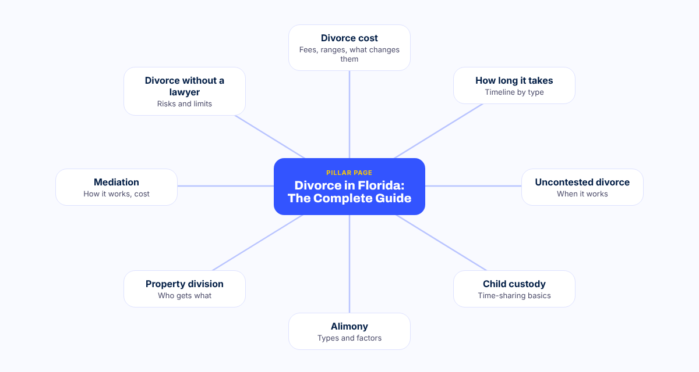
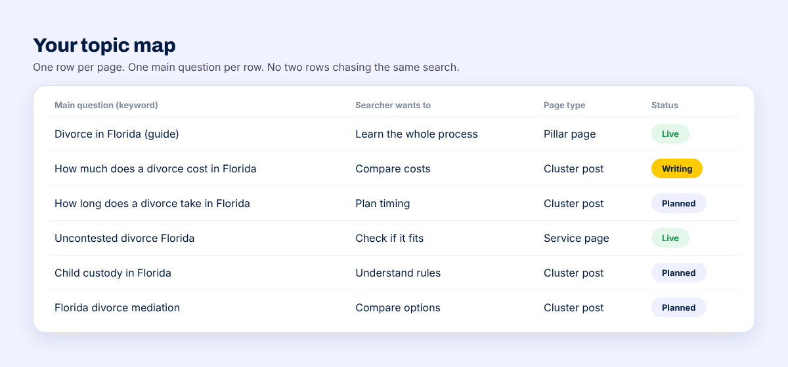
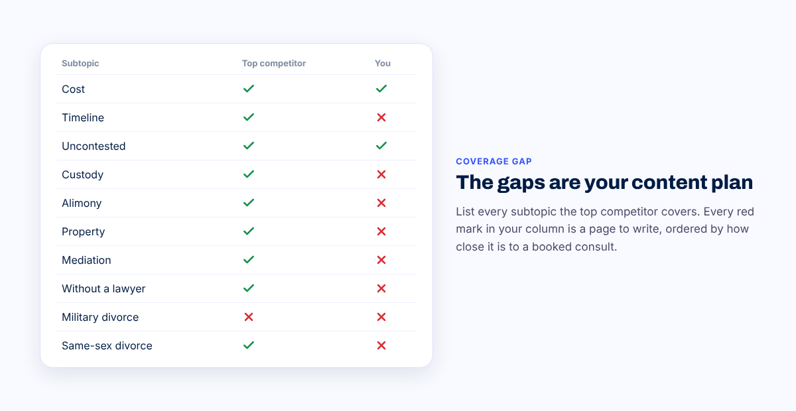
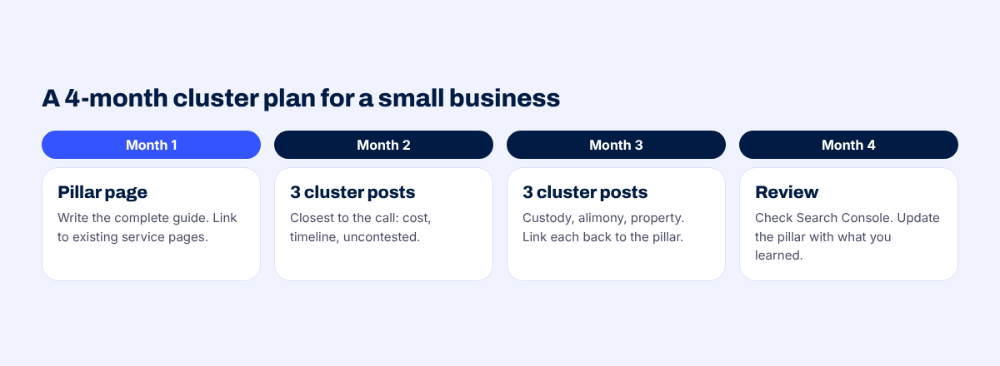

To build topical authority, pick one topic your customers care about and cover it in depth with a topic cluster: one pillar page for the broad topic, linked to focused pages that each answer one question. When you cover a subject that thoroughly, Google and AI tools start to treat you as a go-to source for it.

Most small business blogs don't work this way. A post about one topic, then something unrelated, then a holiday greeting, then nothing for three months. Each post stands alone, and none of them rank well.

Depth matters more now. Industry analysis of Google's 2026 core updates found that topical authority and first-hand experience kept winning over strategies built on publishing volume.

Here's how to build it, step by step. I'll use a made-up family law firm in Florida as the example.

## What topical authority is (and isn't)

Topical authority means your site covers a subject in enough depth that search engines trust it for the whole range of related questions. Not just one keyword.

It isn't about word count or posting every day. A site with 12 strong, connected pages on divorce in Florida will usually beat a site with 200 random legal posts. Google is looking for depth and usefulness on a topic, not volume.

It also helps with AI search. Google's AI Overviews and AI Mode break questions into many related searches, a process Google calls query fan-out, and pull the best page for each. If your site covers the whole topic, you have more chances to be one of those pages. I explain this in more detail in [how to show up in Google AI Overviews](/blog/how-to-show-up-in-google-ai-overviews/).

## The model: pillar pages and topic clusters

A topic cluster has two parts:

- **A pillar page** that covers the broad topic from start to finish. For our law firm: *Divorce in Florida: The Complete Guide*.
- **Cluster pages** that each go deep on one subtopic: cost, timeline, uncontested divorce, custody, alimony, property, mediation, and so on.

The pillar gives a short answer on each subtopic and links to the cluster page for the full detail. Each cluster page links back to the pillar and to related clusters. The links tell Google these pages belong together, and they help visitors find the next answer they need.

## Step 1: Pick one core topic

Start with one topic, not five. Choose the one that:

- Brings in your best clients or highest-value jobs
- You have real expertise and experience in
- Has enough related questions to support 10 or more pages

For a family law firm, that might be divorce. For a dental clinic, implants or Invisalign. For a plumber, water heaters. You can build a second cluster later, once the first one is working.

## Step 2: List every question your customers ask

This is your raw material. Gather questions from:

- **Google's "People also ask" box** and autocomplete for your main topic
- **Your own calls and emails.** What do people ask before they book?
- **Your Search Console data.** Look at the queries you already get impressions for
- **AI tools.** Ask ChatGPT what questions people have about your topic, then check them against real search data
- **Forums like Reddit**, where people describe their situation in their own words

Don't filter yet. Aim for 40 to 60 questions.

## Step 3: Group questions into pages

Now sort the questions into groups. Each group becomes one page. Questions that a searcher would expect answered together belong on the same page.

For example, "How much does a divorce cost in Florida?", "Are attorney fees split?" and "What's the filing fee?" all belong on one cost page. "How long does a divorce take?" gets its own page, because it's a different question with a different answer.

Put it in a simple topic map: one row per page, with the main question, what the searcher wants to do, the page type and its status. The golden rule: **one main question per page.** If two rows target the same search, merge them. Otherwise your pages compete with each other, which is called keyword cannibalization.

## Step 4: Find the gaps

Look at the site that ranks best for your main topic. List every subtopic it covers, and compare it with what you have.

Every gap is a page to write. Order them by how close they are to a booked appointment or job. For a law firm, "how much does a divorce cost" is closer to a consult than "history of divorce law," so it goes first.

Also look for gaps your competitor missed. Those are your chance to be the only good answer.

## Step 5: Write each page with real expertise

This is what separates topical authority from content filler. Each page should include something only your business can offer:

- **Real numbers** from your own work, like typical timelines or price ranges
- **Local detail**, like the rules, courts, permits or conditions where you operate
- **Common mistakes** you've seen clients make, and how to avoid them
- **A clear author** with credentials, so readers and search engines know who's behind it

Answer the main question in the first two sentences. Then go deeper. Use headings phrased the way people search, and finish with a clear next step, like booking a consult.

AI tools can help with outlines and first drafts. But the expertise has to come from you. I cover how to do that safely in [does AI-generated content rank on Google?](/blog/does-ai-generated-content-rank/)

## Step 6: Link the cluster together

Internal links are what turn separate pages into a cluster. Follow three rules:

1. **The pillar links to every cluster page**, with descriptive anchor text like "how long a Florida divorce takes."
2. **Every cluster page links back to the pillar**, usually near the top and in the conclusion.
3. **Cluster pages link to each other** where it helps the reader. The cost page links to the mediation page, because mediation often lowers cost.

Also link from your related service page. For our law firm, the "uncontested divorce" service page should link to the pillar and the most relevant cluster pages.

## Step 7: Publish on a steady plan

You don't need to publish everything at once. A steady pace works fine for a small business.

A realistic four-month plan:

- **Month 1:** Write the pillar page. Link it to your existing service pages.
- **Month 2:** Write the three cluster pages closest to a booking.
- **Month 3:** Write three more. Link each back to the pillar and to each other.
- **Month 4:** Review Search Console. See which pages get impressions, which queries are new, and update the pillar with what you learned.

That's seven strong pages in four months. Keep going until the cluster covers the main questions, then start your second topic.

## How to tell if it's working

Give the cluster three to six months, then look for:

- **More queries.** In Search Console, the number of different searches your cluster pages show up for should grow.
- **Rising average position** for the pillar page's main keyword.
- **AI citations.** Check the Generative AI performance report in Search Console, and ask AI tools your topic's main questions to see if you're cited.
- **Leads from the cluster.** Track which pages people visit before they book or call.

Topical authority builds slowly, then all at once. The first few pages may not move much. But as the cluster fills in, the whole topic starts to lift together.

If you'd like help mapping your first cluster, that's the core of my [content strategy service](/services/content-strategy/). Or [book a free call](/contact/) and we'll sketch it out together.
