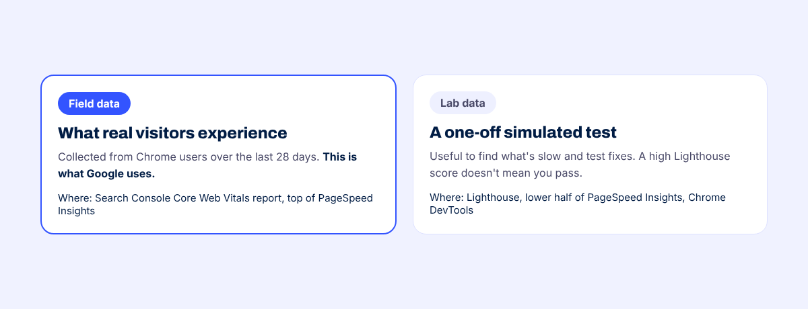
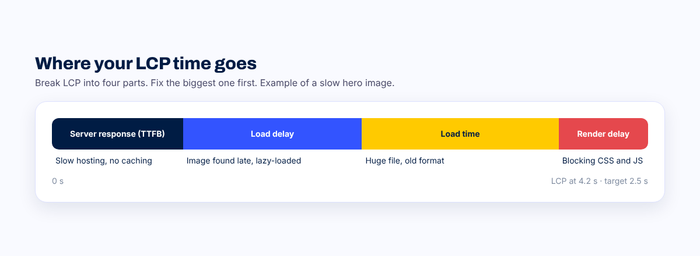
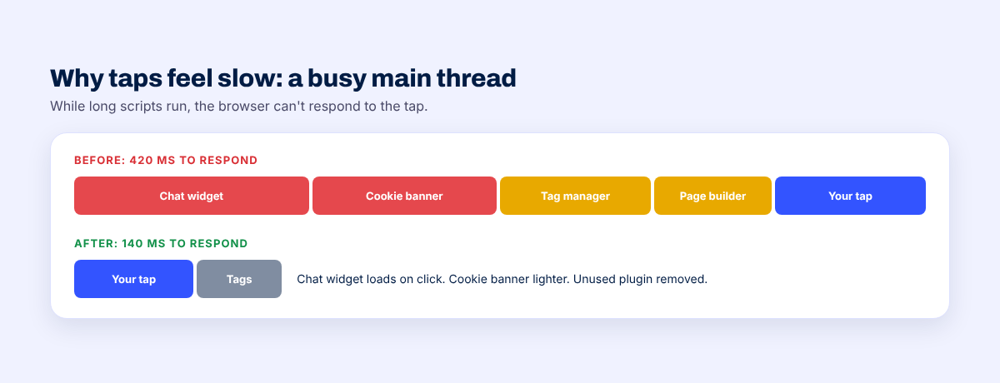
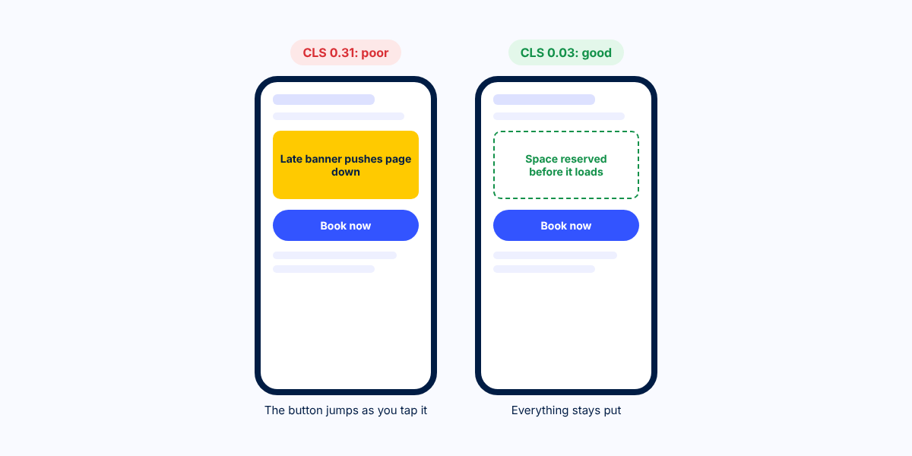
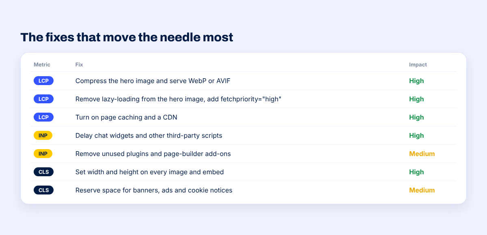

You've opened PageSpeed Insights, seen a lot of red, and a long list of warnings you don't understand. Where do you even start?

Here's the good news. On most small business websites, a handful of the same problems cause most Core Web Vitals failures. Fix those, and you usually pass. This guide walks through how to find what's actually slowing your pages, then fixes each metric in order of impact.

If you need a refresher on what the three metrics mean and their targets, they're covered in my [technical SEO audit checklist](/blog/technical-seo-audit-checklist/). In short: **LCP** is loading speed (2.5 seconds or less), **INP** is responsiveness (200 ms or less), and **CLS** is visual stability (0.1 or less).

## Step 1: Check the right data first

Before you fix anything, make sure you're looking at the numbers Google actually uses.

- **Field data** comes from real Chrome visitors over the last 28 days. Google uses this. You'll find it in Search Console's **Core Web Vitals** report and at the top of PageSpeed Insights, under "Discover what your real users are experiencing."
- **Lab data** is a one-off simulated test, like the Lighthouse score. It's great for finding what's slow and testing fixes, but a score of 95 doesn't mean you pass.

Start in Search Console. Open **Experience › Core Web Vitals** and look at the **Mobile** report first. Most local searches happen on phones, and mobile is usually where sites fail. The report groups similar pages together and tells you which metric is failing for each group. Pick one example URL from the worst group, and run it through [PageSpeed Insights](https://pagespeed.web.dev/).

> **Tip:** If your site doesn't get enough traffic, Search Console may show "Not enough data." In that case, use the lab data in PageSpeed Insights as your guide, and test on a real phone.

## Step 2: Fix LCP (slow loading)

LCP measures how long the biggest thing on the screen takes to appear. On most business sites, that's the hero image at the top of the page. Sometimes it's a large headline.

### Find your LCP element

In PageSpeed Insights, scroll to the **Insights** section and open **LCP breakdown**. It shows exactly which image or text block is your LCP element, and splits its time into four parts.

Fix the biggest part first:

**Slow server response (TTFB).** If the page's HTML takes more than about 800 ms to arrive, nothing else can start. Fixes:
- Turn on page caching. On WordPress, use your host's built-in caching or a plugin like WP Rocket or LiteSpeed Cache.
- Use a CDN like Cloudflare so pages are served from a location near the visitor.
- If you're on cheap shared hosting, consider better hosting. No front-end fix can make up for a slow server.

**Load delay.** The browser finds the image too late. Fixes:
- **Don't lazy-load the hero image.** Lazy-loading is great for images further down, but on the main image it delays LCP. Check your theme or plugin settings.
- Add `fetchpriority="high"` to the hero image so the browser loads it first. Recent versions of WordPress do this automatically for the first large image.
- Avoid hero images set as CSS backgrounds or loaded by a slider script. A plain `` tag is found much sooner.

**Load time.** The image file is too big. Fixes:
- Resize it to the largest size it actually displays at. A 4000-pixel photo shown at 1200 pixels is wasted download.
- Serve it as **WebP or AVIF**. These are often much smaller than JPEG or PNG at the same quality.
- Compress it. Most image plugins and CDNs do this automatically.

**Render delay.** The image is downloaded, but blocking CSS or JavaScript stops it from showing. Fixes:
- Remove unused CSS and JavaScript, especially from plugins that load on every page.
- Defer scripts that aren't needed to show the top of the page.

## Step 3: Fix INP (slow responses to taps and clicks)

INP measures how fast your page reacts when someone taps a button, opens a menu or fills in a form. When it's slow, the page feels broken, even if it loaded quickly.

The cause is almost always the same: **too much JavaScript running on the browser's main thread.** While a long script is running, the browser can't respond to the tap. The usual culprits on business sites:

- **Chat widgets.** Many load a lot of JavaScript on every page. Load them only when someone clicks the chat button, or after the page settles.
- **Cookie consent banners.** Some are surprisingly heavy. Choose a lightweight one.
- **Tag managers full of old tags.** Audit your Google Tag Manager container and remove tracking you no longer use.
- **Page builders and their add-ons.** Each add-on can attach scripts to every click. Disable modules you don't use.
- **Too many plugins.** On WordPress, a plugin like Query Monitor shows which plugins load scripts on each page.

To find the exact problem, open the page in Chrome, open **DevTools › Performance**, record a session while you click around, and look for long tasks over 50 ms. In PageSpeed Insights, a high **Total Blocking Time** in the lab data is a good sign INP trouble is coming.

## Step 4: Fix CLS (layout jumps)

CLS measures how much the page shifts while it loads. You've seen it: you go to tap a button, an image loads above it, and you tap the wrong thing.

The fixes are usually simple:

- **Set width and height on every image and video.** This lets the browser reserve the right amount of space before the file loads. Most modern themes do it automatically, but check images added by page builders.
- **Reserve space for anything that loads late.** Ads, embedded maps, review widgets, promo bars and cookie banners. Give them a fixed minimum height in your CSS.
- **Don't insert content above what's already there.** A "Book now" bar that slides in at the top pushes everything down. Put it at the bottom or overlay it instead.
- **Load fonts carefully.** Fonts that swap in late can change text size and push lines around. Use `font-display: swap` with a fallback font of a similar size, or host your fonts locally.

In PageSpeed Insights, the **Layout shift culprits** insight shows which elements moved.

## The fixes that make the biggest difference

If you only have an afternoon, start here. These fix most failures on small business sites:

1. Compress the hero image and serve it as WebP or AVIF.
2. Remove lazy-loading from the hero image and add `fetchpriority="high"`.
3. Turn on page caching and a CDN.
4. Delay chat widgets and other third-party scripts.
5. Set width and height on every image and embed.

Then work through the rest: unused plugins, heavy page-builder add-ons, and space for late-loading banners.

## Step 5: Validate the fix

Once your changes are live:

1. Re-test the page in PageSpeed Insights and check the lab numbers improved.
2. In Search Console, open the Core Web Vitals report, click the issue you fixed, and click **Validate fix**.
3. Wait. Field data covers the last 28 days, so improvements build gradually. Search Console monitors the pages over the next 28 days and tells you if the fix passed.

Don't panic if the field numbers don't move for a week or two. That's normal.

## A note on WordPress

WordPress powers a lot of small business sites, and it can pass Core Web Vitals easily with the right setup. The most common problems I see are a heavy theme, a page builder loading on every page, too many plugins, and cheap hosting. Before you install another "speed" plugin, try removing something instead. It's often the faster fix.

Speed is one part of technical SEO. Once your pages are fast, make sure Google can crawl and index them. My guide to [fixing "crawled, currently not indexed"](/blog/how-to-fix-crawled-currently-not-indexed/) covers that. If you'd like an expert to find and fix your Core Web Vitals issues, that's part of my [technical SEO service](/services/technical-seo/), or you can [book a free call](/contact/).
