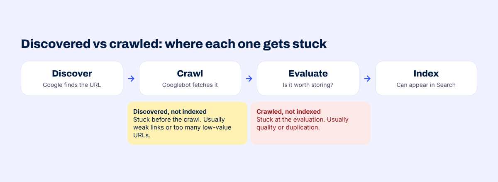
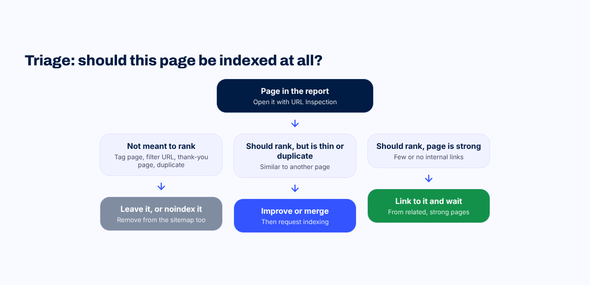
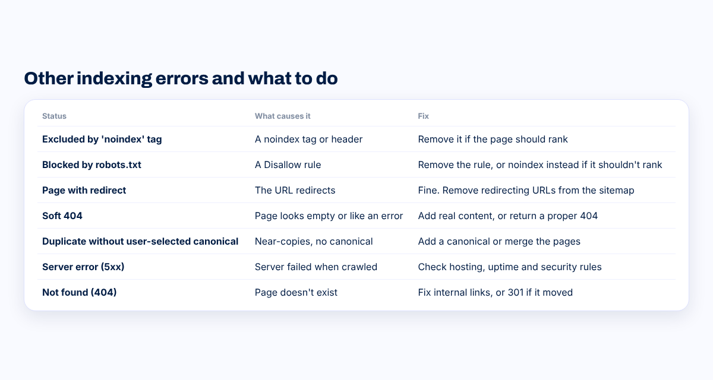
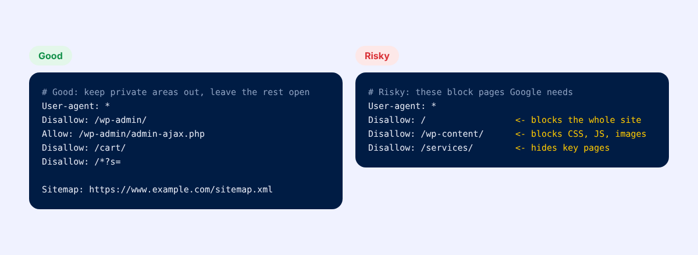
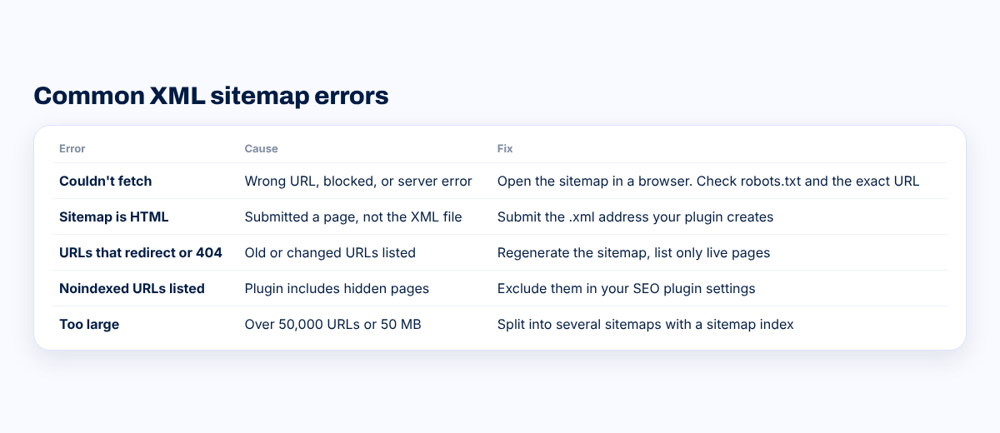

You published a page, waited a week, and opened Search Console. Instead of "Indexed," it says **"Crawled, currently not indexed."** Google visited, read the page, and passed.

It's one of the most common and most frustrating statuses in Search Console. The good news is that it's usually fixable, once you know what it really means. This guide covers how to fix it, how it differs from "Discovered, currently not indexed," and how to solve the other errors you'll find in the same report, including robots.txt and sitemap problems.

## What "crawled, currently not indexed" actually means

Google processes pages in stages. It discovers a URL, crawls it, evaluates it, and then decides whether to store it in the index. Only indexed pages can appear in search results, and in AI Overviews.

"Crawled, currently not indexed" means the page got stuck at the **evaluation** stage. Google read it and decided it wasn't worth storing, at least for now. That's a judgment call, not an error. Google doesn't tell you the reason, but in practice it almost always comes down to one of these:

- The page is **thin**: little content, or nothing that isn't already on other pages.
- The page is a **near-duplicate** of another page on your site or elsewhere.
- The page has **few or no internal links**, so Google sees it as unimportant.
- The site has **lots of low-value URLs**, so Google is selective about what it keeps.

"Discovered, currently not indexed" is different. Google found the URL but hasn't crawled it yet. That's usually about crawl priority: weak internal links, a slow server, or too many URLs competing for Google's attention.

## Step 1: Decide whether the page should be indexed

Not every page in the report is a problem. Before you fix anything, open each URL with the **URL Inspection** tool and ask: should this page rank?

- **Pages that aren't meant to rank**, like tag archives, filtered URLs, internal search results, thank-you pages and printer versions. Leave them out of the index, add `noindex` if you like, and remove them from your sitemap.
- **Pages that should rank, but are thin or duplicate.** Improve them or merge them. See step 2.
- **Strong pages that simply aren't linked well.** Add internal links. See step 3.

Export the list from Search Console and sort it into these three groups first. It saves a lot of wasted effort.

## Step 2: Improve or merge thin and duplicate pages

For pages that should rank but aren't being indexed, make them clearly worth storing:

- **Add something unique.** Real information from your business: prices, examples, local detail, photos, answers to customer questions. Pages that only repeat what other sites say are the most likely to be skipped.
- **Merge near-duplicates.** If you have several pages on almost the same topic, such as separate location pages that only swap the suburb name, combine them into one stronger page and 301 redirect the others.
- **Check the canonical.** In URL Inspection, compare the **user-declared canonical** with the **Google-selected canonical**. If Google picked a different page, it sees yours as a duplicate. Make sure your canonical tag points to the page itself and matches the live URL exactly. I walk through one tricky version of this in [canonical tag points to a redirect](/blog/canonical-tag-points-to-redirect-trailing-slash/).
- **Make sure the content is in the HTML.** View the page source. If the main text only appears after JavaScript runs, Google may see an almost empty page.

## Step 3: Strengthen internal links

Internal links tell Google which pages matter. A page with no links from the rest of your site looks unimportant, however good it is.

- Link to the page from your **most relevant strong pages**, like the main service page and related blog posts.
- Use descriptive anchor text, like "teeth whitening cost in Austin," not "click here."
- Make sure it's reachable from your menu or a hub page, not only from the sitemap.

This is also the main fix for "Discovered, currently not indexed." Google crawls pages it can reach through links more readily than pages it only finds in a sitemap.

## Step 4: Request indexing and give it time

Once a page is improved:

1. Paste the URL into the **URL Inspection** bar and click **Request Indexing**.
2. For a larger group of pages, open the issue in the Page indexing report and click **Validate fix** after you've changed them.
3. Wait. Many pages are picked up within one to four weeks.

Don't keep requesting indexing on a page you haven't changed. If it's still not indexed after a month, go back to step 2. The page probably needs more value, not more requests.

## Other indexing errors and how to fix them

The same report lists several other reasons pages aren't indexed. Here's what each usually means:

- **Excluded by 'noindex' tag:** The page has a `noindex` meta tag or header. Remove it if the page should rank. A common cause is a staging or "pre-launch" setting left on after a site goes live.
- **Blocked by robots.txt:** A `Disallow` rule stops Google crawling the page. Remove the rule if it should rank. If it shouldn't, use `noindex` instead, since Google can't see a noindex on a page it's not allowed to crawl.
- **Page with redirect:** The URL redirects elsewhere. That's fine for old URLs. Just remove redirecting URLs from your sitemap and internal links.
- **Soft 404:** The page returns a normal status but looks empty or like an error page. Add real content, or return a proper 404 if it's gone.
- **Duplicate without user-selected canonical:** Google found near-identical pages and none has a canonical tag. Add canonicals or merge the pages.
- **Server error (5xx):** Your server failed when Google tried to crawl. Check hosting, uptime, and firewall or security rules that may be blocking Googlebot.
- **Not found (404):** The page doesn't exist. Fix internal links pointing to it, or 301 redirect it if the page moved.

## robots.txt best practices

Your robots.txt file tells search engines which parts of your site they can crawl. Keep it short and simple.

- **Only block what really needs blocking**, like admin areas, carts and internal search results.
- **Never block CSS, JavaScript or image folders.** Google needs them to render your pages properly.
- **Don't use robots.txt to hide pages from search results.** Use `noindex` for that.
- **List your sitemap** on the last line.
- **Check AI crawlers too.** If you want AI tools to cite you, don't block search bots like OAI-SearchBot, Claude-SearchBot and PerplexityBot. I cover these in the [technical SEO audit checklist](/blog/technical-seo-audit-checklist/).

After any change, test the file with the **robots.txt report** in Search Console, under Settings.

## Fixing XML sitemap errors

Your sitemap should be a clean list of every page you want indexed, and nothing else. Submit it in Search Console under **Indexing › Sitemaps** and check its status.

Common problems:

- **Couldn't fetch:** Google couldn't download the file. Open the sitemap URL in your browser to check it loads, and make sure robots.txt doesn't block it.
- **Sitemap is HTML:** You submitted a web page instead of the XML file. Submit the exact `.xml` address your SEO plugin creates.
- **Redirecting or 404 URLs listed:** Old URLs are still in the file. Regenerate it so it lists only live pages.
- **Noindexed URLs listed:** Your plugin is including pages you've hidden. Exclude them in its settings.
- **Too large:** A single sitemap can hold up to 50,000 URLs or 50 MB uncompressed. Bigger sites should split it into several files with a sitemap index.

A clean sitemap won't force Google to index weak pages. But a messy one sends mixed signals and makes it harder for Google to find the pages that matter.

## Keep an eye on it

Indexing isn't something you fix once. Check the **Page indexing** report every month, especially after you publish new pages, change themes or plugins, or migrate your site. A sudden jump in "Crawled, currently not indexed" or "Excluded by noindex" after a change is usually a sign something went wrong.

If you'd like help working through your indexing report, it's part of my [technical SEO service](/services/technical-seo/). Or [book a free call](/contact/) and we'll look at your Search Console together.
