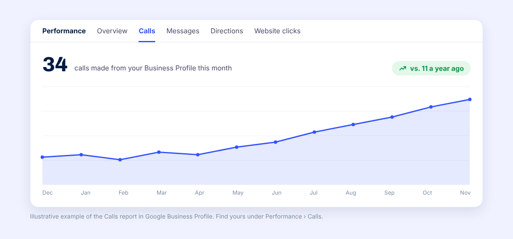
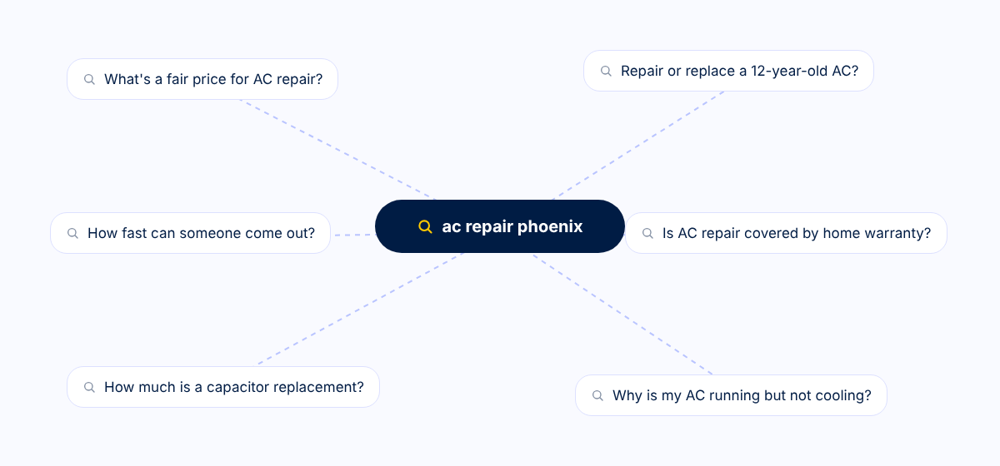
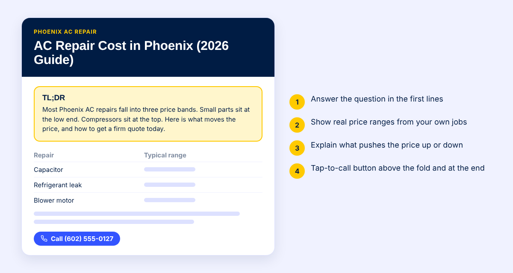
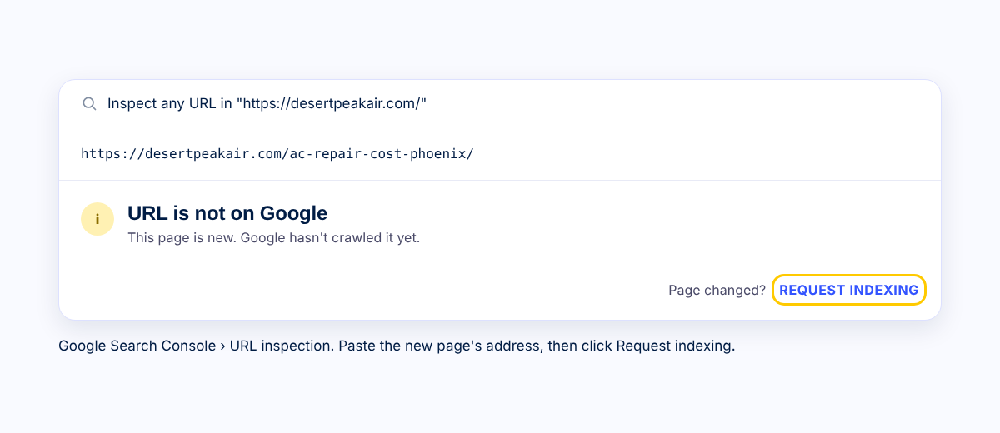
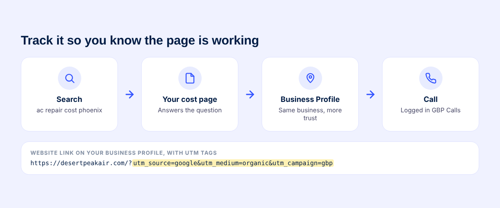

To get more calls from your Google Business Profile, find the question customers ask right before they call, like what a job costs, and build one page on your website that answers it clearly. Most people research before they pick up the phone, and they call the business that answers their question first.

If your profile gets views but the phone stays quiet, the problem usually isn't the profile itself. It's what customers find when they look a little deeper. *How much will this cost? Can I fix it myself? Is this an emergency?* The business that answers clearly is the one they trust enough to call.

This guide shows you how to find that question and build one page around it. I'll use a made-up AC repair company in Phoenix, Desert Peak Air, to show each step.

## Where your Google Business Profile calls come from

Start by checking where you stand. Open your Business Profile on Google while signed in, choose **Performance**, and look at **Calls**. That number counts every time someone taps the Call button on your profile.

Write down your current monthly number. It's your baseline. It doesn't catch people who copy your number and dial it themselves, so your real call volume is higher. But it's the best free way to see if your changes are working.

Here's the connection most business owners miss. Your profile and your website work as a team. Google uses your website to understand what you do and how well you do it. And many customers tap through to your site before they call. If your site answers their question, the call comes next. If it doesn't, they go back to the map and try someone else. Some marketers call this search-to-call SEO: getting found in search, then making it easy for that visit to turn into a phone call.

## Step 1: Search your service and city like a customer

Open Google in a private window and search exactly what your customer would. For Desert Peak Air, that's "ac repair phoenix."

Don't look at the ads or the map pack yet. Scroll down to the **People also ask** box. These are real questions people search around your service. Click a few. Each one you open adds more questions to the list.

Then go back to the search bar. Start typing questions, like "how much is ac repair" or "why is my ac," and watch Google's **autocomplete** suggestions. Those come straight from what people type.

Copy every question into a list. In twenty minutes you'll have more content ideas than you can use, and every one comes from a real customer.

> **Pro tip:** Ask your front desk or whoever answers the phone what people ask before they book. Their top three questions are often the same ones in People Also Ask. That's your confirmation.

## Step 2: Pick the question closest to the call

Not every question is worth a page. Some people are just curious. Others are one answer away from picking up the phone. You want the second group.

Look for questions that show someone has a real problem and is weighing their options:

- **Cost questions:** "What's a fair price for AC repair?" "How much is a capacitor replacement?"
- **Repair or replace questions:** "Should I repair or replace a 12-year-old AC?"
- **Urgency questions:** "Is it an emergency if my AC stops working in summer?"
- **Trust questions:** "How do I know if an AC company is overcharging me?"

In most service businesses, the cost question wins. People ask it right before they call, and most competitors avoid answering it. That gap is your opening.

## Step 3: Build one page that answers it properly

Now build a page that answers that one question better than anything else on Google. For Desert Peak Air, that page is **AC Repair Cost in Phoenix (2026 Guide)**.

Here's the structure I use:

1. **A TL;DR box at the top.** Two or three sentences with the direct answer. Busy readers get what they came for. Google and AI tools get a clean answer to quote.
2. **Real price ranges from your own jobs.** Pull your last six months of invoices and group them by repair type. Ranges are fine. Honest ranges from real work beat national averages copied from somewhere else.
3. **What makes the price go up or down.** System age, part availability, after-hours calls, warranty coverage. This shows you know the job and prepares customers for the quote.
4. **When to repair and when to replace.** Customers want guidance, not a sales pitch. Giving it honestly builds trust.
5. **A clear next step.** A tap-to-call button near the top and again at the end. Add your service area and hours right next to it.

Write it the way you'd explain it to a customer on the phone. Short sentences. No jargon without an explanation. If a photo from a real job fits, use it.

> **Pro tip:** Put the year in the title, like "(2026 Guide)," only if you'll update the prices every year. A stale year in the title hurts trust faster than no year at all.

## Step 4: Get the page indexed fast

A new page can sit for weeks before Google finds it. Don't wait.

1. Open [Google Search Console](https://search.google.com/search-console) and paste the new page's address into the **URL inspection** bar at the top.
2. Click **Request indexing**.
3. Link to the new page from your main service page and from your homepage, if it fits. Internal links help Google find and value it.
4. Share it from your Business Profile as a post or an update, with a link to the page.

If Search Console isn't set up yet, it takes five steps and costs nothing. Here's [how to set up Google Search Console](/blog/how-to-set-up-google-search-console/).

## Step 5: Track whether it brings in calls

You built the page to get calls, so measure calls. Three numbers tell the story:

- **Search Console:** Within a few weeks, check the page in the Performance report. Look for impressions on cost-related searches. That tells you Google is showing it.
- **Business Profile Calls:** Compare your monthly calls with your baseline from the start.
- **Website visits from your profile:** Add UTM tags to the website link on your Business Profile, like `?utm_source=google&utm_medium=organic&utm_campaign=gbp`. Then Google Analytics can show you exactly how many visits come from your profile and what pages they land on.

If you use call tracking software, make sure your Google Business Profile setup still shows your main local number as an additional phone. I explain why in my guide to [NAP consistency](/blog/nap-consistency-local-seo/).

## Repeat it for your next question

One strong page can move your calls. Five of them can change your month. Once the first page is live, go back to your question list and pick the next one closest to the call.

A simple rhythm that works: one new question page a month, built from real customer questions, each linked from the service page it supports. After six months, your site answers the questions your competitors ignore. Google notices, AI tools quote you, and customers call you because you already helped them.

If you want help picking the right questions or building the pages, that's what my [content strategy service](/services/content-strategy/) covers. Or [book a free call](/contact/) and we'll look at your Business Profile together.
