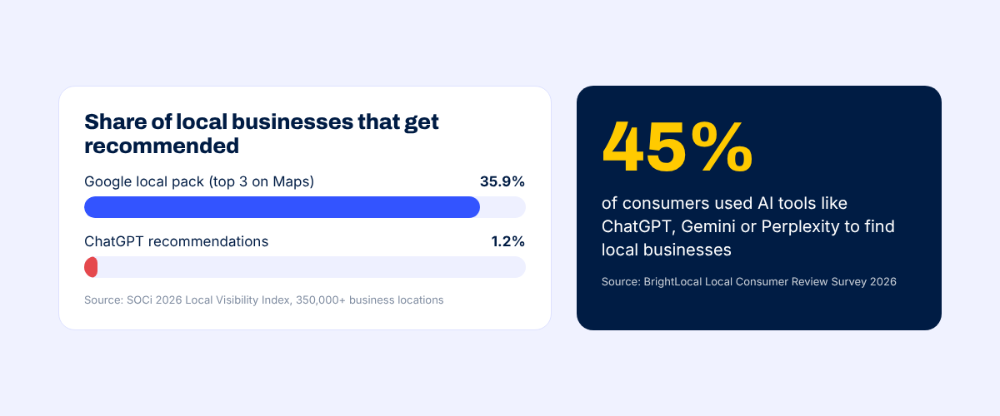
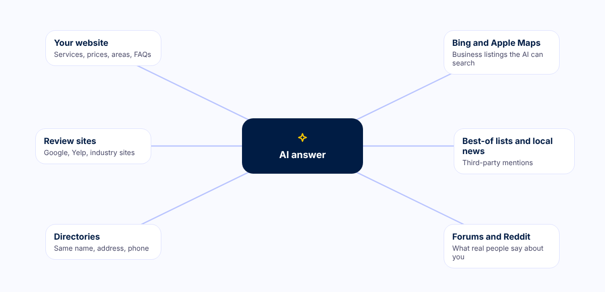
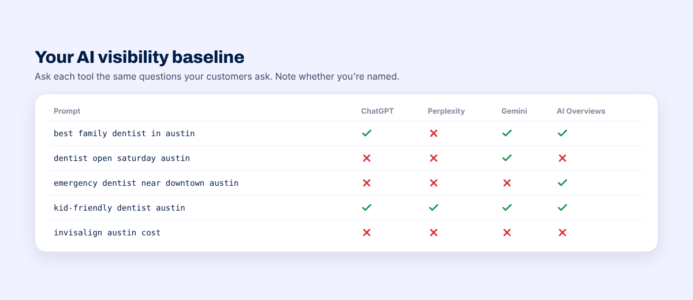
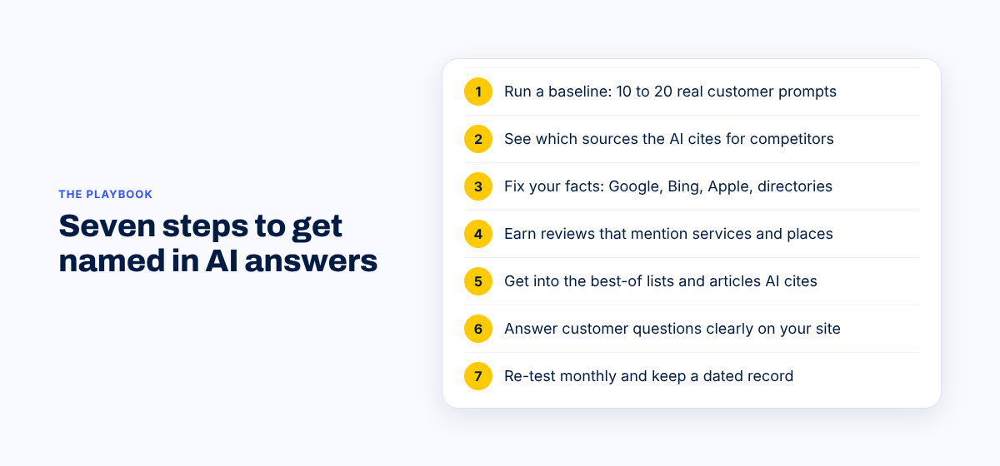

To get your business recommended by ChatGPT, make sure AI tools can confirm the same facts about you across many sources: your website, your listings, your reviews and third-party articles. AI assistants name the businesses they can verify, so fix your facts first, then earn reviews and mentions in the places AI already looks.

Ask ChatGPT "who's a good family dentist near me" and it won't hand you ten blue links. It names two or three businesses, says why, and offers to help you contact them. If you're not on that short list, you don't exist for that customer.

That moment is happening more often. BrightLocal's 2026 Local Consumer Review Survey found that **45% of consumers** have used AI tools like ChatGPT, Gemini or Perplexity to find local businesses. But very few businesses get named. The SOCi 2026 Local Visibility Index looked at more than 350,000 business locations and found that **ChatGPT recommends just 1.2% of them**, compared with **35.9%** that show up in Google's local pack.

That gap is the opportunity. Here's how AI assistants pick businesses, and a seven-step plan to get yours on the list. I'll use a made-up practice, Brightside Family Dental in Austin, as the example.

## How AI assistants decide who to recommend

When someone asks for a local recommendation, ChatGPT and similar tools search the web in real time. They read what they find, then name the businesses they can confirm from more than one source.

Think of it as the AI asking, "Can I trust this?" It looks for:

- **Consistent facts.** The same name, address, phone and hours across your website, listings and directories.
- **Reviews.** Not just star ratings, but what people say. A review that mentions "Saturday appointments" helps you get named for that question.
- **Third-party mentions.** Best-of lists, local news, industry roundups and community forums. These are often the sources the AI cites.
- **Clear service information.** A website that says plainly what you do, where, for whom, and roughly what it costs.

If your details conflict, or the only place that mentions you is your own site, the AI has little reason to take the risk. It names someone it can verify instead.

## Step 1: Find out where you stand right now

Before you change anything, run a baseline. Write down 10 to 20 questions your customers really ask. Mix broad ones with specific ones:

- "best family dentist in Austin"
- "dentist open Saturday Austin"
- "kid-friendly dentist near South Austin"
- "how much is Invisalign in Austin"

Ask each one in ChatGPT, Perplexity, Gemini and Google (watch the AI Overview). Use a fresh chat each time, and note whether you're named.

Save it in a spreadsheet with the date. AI answers change week to week, so one check is a snapshot. A dated record over months is what tells you if things are working. I cover a simple tracking setup in [how to track AI search traffic](/blog/how-to-track-ai-search-traffic/).

## Step 2: See which sources the AI cites for your competitors

This is the step most people skip, and it's the most useful. When ChatGPT or Perplexity names a competitor, look at the sources it links to. Perplexity shows them by default. In ChatGPT, open the sources panel.

You'll usually see a pattern. Maybe a local magazine's "best dentists" list shows up again and again. Maybe a Yelp page, a Reddit thread or a review site. Those are the places the AI trusts for your area and industry. Write them down. They're your target list for steps 4 and 5.

## Step 3: Fix your facts everywhere AI looks

AI tools cross-check details before they state them. If your hours say 8 to 5 on Google and 9 to 6 on Yelp, the AI may skip you, or worse, give out the wrong hours.

Start with the platforms that feed AI search:

1. **Google Business Profile.** Complete every field: categories, services, hours, attributes, photos.
2. **Bing Places for Business.** Many owners never claim it, and industry research points to Bing data as a major input for ChatGPT's local answers.
3. **Apple Business Connect.** This feeds Apple Maps and Siri.
4. **Yelp, Facebook and your industry directories.** For dentists, that's sites like Healthgrades and Zocdoc. For lawyers, Avvo and Justia.

Use exactly the same name, address and phone on each one. My [NAP consistency playbook](/blog/nap-consistency-local-seo/) walks through this step by step, including how to find and fix duplicate listings.

## Step 4: Earn reviews that describe what you do

Reviews do two jobs for AI search. They prove you're real and well regarded. And their words help the AI match you to specific questions.

A review that says "great dentist" helps a little. A review that says "they fit my son in on a Saturday and were so patient with him" helps you get named for "kid-friendly dentist open Saturday." You can't write reviews for customers, but you can make it easy for them to share details:

- Ask soon after a good visit, while it's fresh.
- In your request, mention what they came in for: "If you have a minute, we'd love to hear how your Invisalign consult went."
- Reply to every review, and mention the service and area naturally in your reply.

Never buy reviews or offer rewards for positive ones. Google, Yelp and most platforms ban it, and AI tools that spot fake patterns may ignore you entirely.

## Step 5: Get into the lists and articles AI already cites

Go back to the sources from step 2. These are the pages that shape AI answers for your area. Your goal is to be included in them, honestly.

- **Best-of lists:** Many local publications update them every year. Email the writer with a short, specific pitch: what you do differently, a few review quotes, and a photo.
- **Local news and community sites:** Sponsor a local event, share expert comments on a timely topic, or offer a free community clinic or talk.
- **Industry roundups and associations:** Make sure you're listed with your professional bodies and chambers of commerce.
- **Forums like Reddit:** Join conversations in your local subreddit as yourself, helpfully, without spamming links. AI tools often cite these threads because they reflect real opinions.

Make sure each mention includes your full business name, and ideally your city and a link. That's what lets the AI connect the mention to you.

## Step 6: Answer customer questions clearly on your website

When the AI does visit your site, make it easy to understand and quote. For each main service, have a page that answers the questions people ask before they book:

- What the service is and who it's for
- Where you offer it, and your service area
- A price range or what affects the cost
- How long it takes, and what to expect
- Your hours, how to book, and your phone number

Put the direct answer in the first two sentences of each section. Add `LocalBusiness` schema with your name, address and phone, matching your listings exactly. And check your robots.txt allows AI search bots like OAI-SearchBot and PerplexityBot. I cover that in the [technical SEO audit checklist](/blog/technical-seo-audit-checklist/).

## Step 7: Re-test every month

Run the same prompts from step 1 on the same day each month. Track three things:

- Were you named?
- Which competitors were named instead?
- Which sources were cited?

When a new source starts appearing, add it to your list from step 5. When you start getting named for one question, look at what helped and repeat it for the next one.

## What not to waste money on

AI search has attracted a lot of quick-fix offers. Be careful with:

- **Guaranteed ChatGPT placement.** Nobody can guarantee it. AI answers change constantly.
- **Planted mentions or fake reviews.** Google's own guidance on AI search calls inauthentic mentions a spam risk. They can also backfire publicly.
- **Mass-produced "AI-optimized" pages.** Hundreds of thin pages for every suburb and service rarely help, and Google's spam policies target this kind of scaled content.

The work that gets you recommended is the same work that builds a good local reputation: accurate listings, real reviews, genuine mentions and a helpful website. AI just makes it more visible when you've done it.

If you'd like help running your baseline and building a plan, that's what my [AI search visibility service](/services/ai-search-visibility/) covers. Or [book a free call](/contact/) and we'll check how ChatGPT sees your business today.
