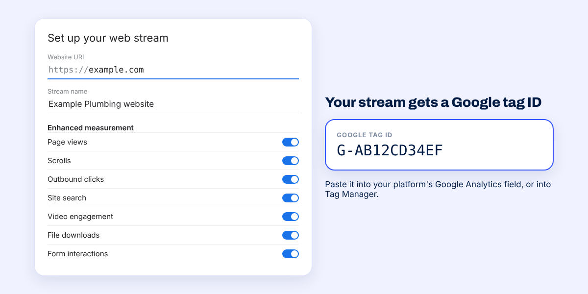
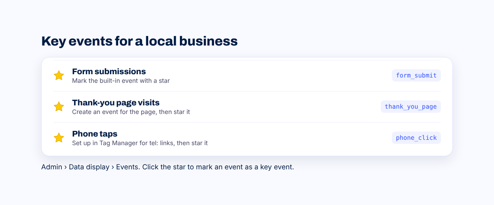
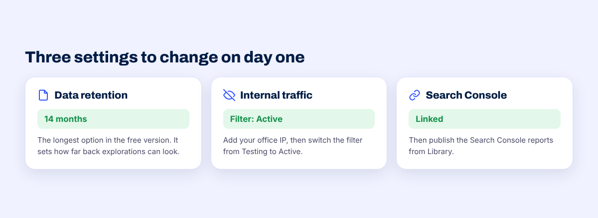

To set up Google Analytics 4, create a free account at analytics.google.com, add a property and a web data stream, then install the Google tag on your website. Data can take up to 30 minutes to start showing in the Realtime report, and your full reports fill in within a day or two.

Getting useful data takes a few extra settings that most guides skip. Below you'll find each step, the fastest way to add the tag on your platform, the settings to change on day one, and how to track the enquiries that matter to a local business.

## Step 1: Create a Google Analytics account

Go to [analytics.google.com](https://analytics.google.com), sign in with a Google account, and click **Start measuring**. Give the account your business name and choose your data-sharing settings.

Use a Google account your business controls, not a staff member's personal one. Whoever creates the account starts as its administrator. If they leave, you need them to hand over access.

## Step 2: Create a GA4 property

A property holds the data for one website or app. Enter a property name, then pick your **reporting time zone** and **currency**. Use the time zone where your business operates, so "today" in your reports matches your working day.

Next, answer the questions about your business size and goals. Google uses them to choose which reports to show by default. You can change those reports later.

## Step 3: Add a web data stream

A data stream connects your website to the property. Choose **Web**, enter your website address, name the stream, and make sure **Enhanced measurement** is switched on. Then click **Create stream**.

Enhanced measurement tracks these actions automatically, with no extra code:

- Page views
- Scrolls to 90% of a page
- Clicks on links to other websites
- Site searches
- Embedded YouTube video plays
- File downloads
- Form starts and submissions

Your stream gets a **Google tag ID** that starts with `G-`. You'll need it in the next step.

## Step 4: Install the Google tag on your website

Pick the easiest method for your platform. Most website builders have a field where you paste your `G-` ID, so you don't touch any code:

| Your website runs on | How to add GA4 |
|---|---|
| WordPress | Google's Site Kit plugin sets up and connects GA4 for you |
| Shopify | The Google & YouTube app adds your GA4 tag |
| Wix, Squarespace, GoDaddy, HubSpot | Paste your G- ID into the Google Analytics field |
| Google Tag Manager | Add a Google tag with your G- ID, firing on all pages |
| Custom site | Paste the Google tag code right after `<head>` on every page |

Google keeps the full list of [platforms that accept a G- tag ID](https://support.google.com/analytics/answer/10447272). Use only one method. Two tags on the same site can count every visit twice.

## Step 5: Check that GA4 is collecting data

Open your website in a new tab, then open **Reports › Realtime** in GA4. You should see yourself as an active user. [Google's setup guide](https://support.google.com/analytics/answer/9304153) says data collection can take up to 30 minutes to begin.

Don't panic if your other reports look empty at first. Google says [data processing can take 24 to 48 hours](https://support.google.com/analytics/answer/11198161), so check them again the next day.

If Realtime stays empty, see the fixes in [common GA4 setup problems](#common-ga4-setup-problems-and-how-to-fix-them) below.

## Step 6: Track enquiries with key events

Key events are the actions you count as wins, like a form submission or a booking. Google renamed them from "conversions" in 2024. For a local business, these are usually the most useful:

- **Form submissions:** go to **Admin › Data display › Events**, find `form_submit`, and click the star to mark it as a key event.
- **Thank-you page visits:** if your form sends people to a thank-you page, create an event for that page and mark it as a key event. It only counts people who actually finished the form.
- **Phone taps:** GA4 doesn't track these by default. Set up a click event for `tel:` links in Tag Manager, then mark it as a key event.

Once these are set, your reports show which pages and traffic sources bring in real enquiries, not just visits.

## Settings to change on day one

Three settings make your data more accurate from the start. Change them before your first month of data comes in.

### Set data retention to 14 months

In **Admin**, open **Data retention** and set event data retention to **14 months**, the longest option in the free version. This setting controls how far back your detailed explorations can look, so set it early.

### Exclude your own visits

Your visits and your staff's skew the numbers. In your data stream, open **Configure tag settings › Define internal traffic** and add your office IP address. Then go to **Admin › Data filters**, find the internal traffic filter, and switch it from **Testing** to **Active**. Google notes that an active filter permanently removes that data, so check it in Testing first.

### Link Google Search Console

Go to **Admin › Product links › Search Console links** and link your Search Console property. You need to be a verified owner in Search Console. The link adds reports that show the Google searches bringing people to each page. If you don't have Search Console yet, here's [how to set up Google Search Console](/blog/how-to-set-up-google-search-console/).

The new reports stay hidden until you publish them from **Library** in the left menu, which trips up a lot of people.

## How to add a team member or your SEO specialist

Go to **Admin › Property access management**, click the **+** button, add the person's email, and choose a role:

| Role | What they can do |
|---|---|
| Administrator | Everything, including managing users |
| Editor | Change all property settings, but not users |
| Marketer | Create audiences, events and key events |
| Analyst | Build and share explorations |
| Viewer | See data and settings only |

Give your SEO specialist **Editor** access so they can set up events and fix settings. Keep **Administrator** access with your business. Google's guide to [GA4 access roles](https://support.google.com/analytics/answer/9305587) lists every permission.

## Common GA4 setup problems and how to fix them

Most problems come from the tag: it's missing, it's blocked, or it's there twice.

| Problem | Likely cause | Fix |
|---|---|---|
| Realtime shows nothing | The tag isn't on the site, or the G- ID is wrong | Check the ID in your platform's settings, and test in a private window |
| Your own visit doesn't show | An ad blocker or cookie banner blocks the tag | Test with the blocker off and cookies accepted |
| Page views look doubled | Two tags, such as a plugin plus manual code | Remove one so only one tag fires |
| Your team inflates the numbers | Internal traffic isn't filtered | Set up the internal traffic filter and make it Active |
| No Search Console reports | The report collection isn't published | Publish it from Library in the left menu |

## What to do after you set up GA4

Give it a month of data, then look at three things: which channels bring visitors, which pages they land on, and which of those lead to key events. That's where you'll find your best pages and your weakest ones.

GA4 also groups visits from tools like ChatGPT into their own channel. Here's [how to track AI search traffic in GA4 and Search Console](/blog/how-to-track-ai-search-traffic/).

Want help turning your GA4 data into more calls and bookings? [Book a free strategy call](/contact/) and I'll walk through your reports with you.
