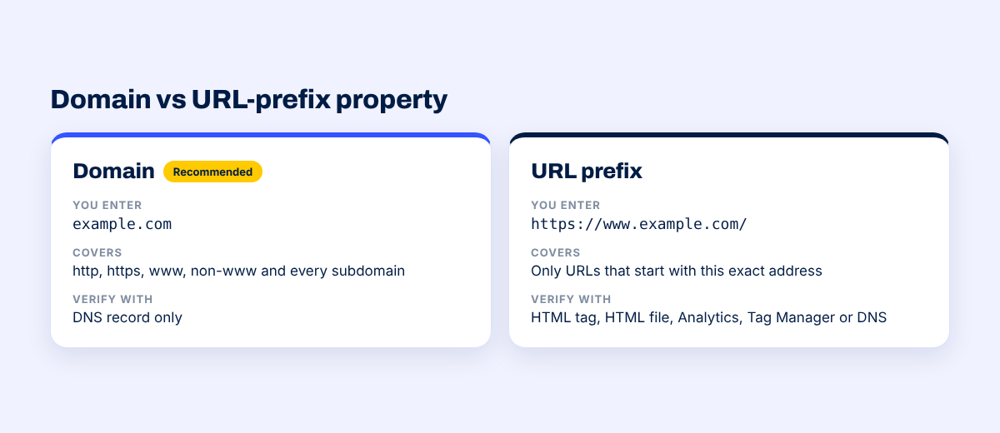
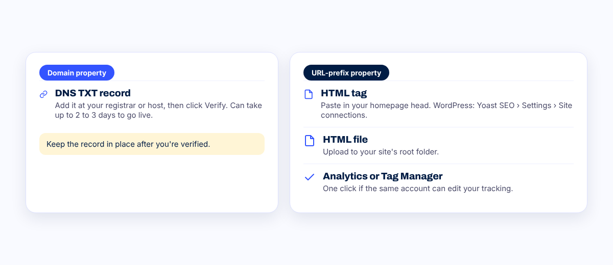
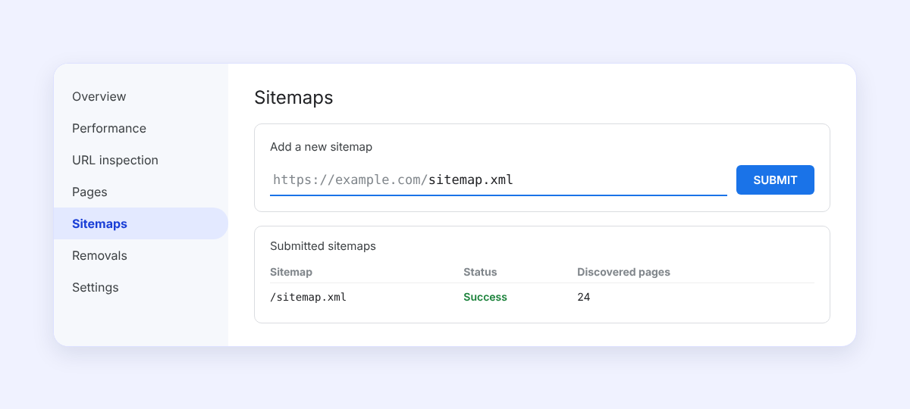
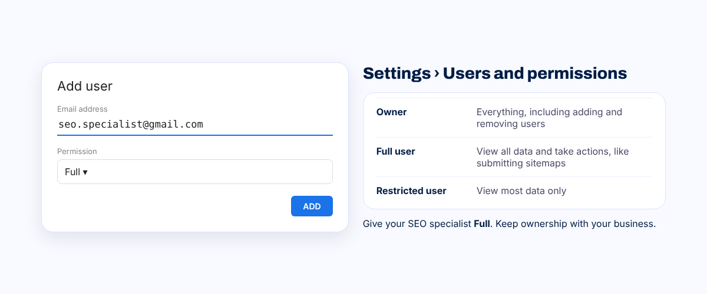

To set up Google Search Console, sign in at search.google.com/search-console with a Google account, add your website as a property, verify that you own it, then submit your sitemap. It's free, and once you're verified, your search data starts showing within a few days.

The setup itself is quick. The parts that trip people up are choosing the right property type and getting verification to stick. Below you'll find each step, which option to pick for your platform, how to give access to a team member, and fixes for the errors I see most often.

## Step 1: Sign in with a Google account

Go to [Google Search Console](https://search.google.com/search-console) and sign in with a Google account. If you don't have one, create a free account first.

Use an account your business controls, not a personal one that belongs to a staff member or web designer. Whoever verifies the site becomes its owner. If that person leaves, you can lose access to your own data. A shared business account, such as a Gmail address for your company, avoids that problem.

## Step 2: Choose a Domain or URL-prefix property

Pick a **Domain property** if you can edit your domain's DNS settings, and a **URL-prefix property** if you can't. Google offers two types, and they cover different parts of your site:

| | Domain property | URL-prefix property |
|---|---|---|
| What you enter | `example.com` | `https://www.example.com/` |
| What it covers | Every subdomain and protocol: http, https, www and non-www | Only URLs that start with that exact address |
| How to verify | DNS record only | HTML tag, HTML file, Google Analytics, Google Tag Manager or DNS |
| Best for | Most businesses | Sites where you can't edit DNS |

A Domain property gives you the full picture, so it's my first choice for almost every site. Enter only the root domain, without `https://` or `www`. Google's guide on [Domain and URL-prefix properties](https://support.google.com/webmasters/answer/34592) explains the finer limits.

## Step 3: Verify that you own the site

Verification proves to Google that the site is yours. Search Console gives you a code, you add it to your domain or website, then you click **Verify**. The method depends on your property type.

### How to verify a Domain property with a DNS record

Copy the TXT record Search Console gives you, then open the DNS settings at your domain registrar or host, such as GoDaddy, Namecheap or Cloudflare. Add a new **TXT** record, paste the value, save it, and click **Verify** in Search Console.

Google notes that it can take up to two or three days for a provider to start serving a new record. If verification fails at first, wait a day and try again. Keep the record in place after you're verified, because removing it can cost you access.

### How to verify a URL-prefix property

Choose the method that fits your setup:

- **HTML tag:** add a meta tag to your homepage's `<head>`. On WordPress with Yoast SEO, paste it under **Yoast SEO › Settings › Site connections**.
- **HTML file:** upload a small file to your site's root folder.
- **Google Analytics or Tag Manager:** verify in one click if the same Google account can edit your Analytics property or Tag Manager container.

Google's own Site Kit plugin for WordPress can also set up and verify Search Console for you. See Google's full list of [verification methods](https://support.google.com/webmasters/answer/9008080).

## Step 4: Submit your sitemap

Submit your XML sitemap so Google can find every page you want indexed. In Search Console, open **Sitemaps** in the left menu, enter your sitemap address, and click **Submit**.

Your sitemap address depends on your platform:

| Platform | Usual sitemap address |
|---|---|
| WordPress with Yoast SEO | `/sitemap_index.xml` |
| Shopify, Wix, Squarespace | `/sitemap.xml` |
| Astro and some other frameworks | `/sitemap-index.xml` |

Not sure? Open your `robots.txt` file at `yoursite.com/robots.txt`. Most sites list their sitemap address there.

A brand-new sitemap often shows **"Couldn't fetch"** with no read date for a day or two. I've seen this on my own site. It usually just means Google hasn't read it yet. If it still fails after a few days, open the sitemap address in your browser and make sure it loads.

## Step 5: Check your data and request indexing

Give Search Console a few days to collect data, then check two reports. **Performance** shows the searches that bring people to your site. **Pages**, under Indexing, shows which pages Google has indexed and why any aren't.

To speed up your most important pages, paste each URL into the **URL Inspection** bar at the top. Click **Test live URL** to confirm Google can read the page, then click **Request indexing**. Start with your homepage and main service pages.

If a page shows as excluded, check the reason before you request indexing again. A stray `noindex` tag is a common one. If the status reads "Crawled, currently not indexed," here's [how to fix crawled but not indexed pages](/blog/how-to-fix-crawled-currently-not-indexed/).

## How to add a team member or your SEO specialist

Only owners can add users. Open your property, go to **Settings › Users and permissions**, click **Add user**, enter the person's Google account email, and pick a permission level:

| Permission | What they can do |
|---|---|
| Owner | Everything, including adding and removing users |
| Full user | View all data and take actions such as submitting sitemaps |
| Restricted user | View most data only |

Give your SEO specialist or agency **full user** access, and keep ownership with your business. Google's guide on [users and permissions](https://support.google.com/webmasters/answer/7687615) lists exactly what each level can do.

## Common setup problems and how to fix them

Most setup problems come from verification, sitemaps or pages that block Google. Here are the ones I see most:

| Problem | Likely cause | Fix |
|---|---|---|
| Verification failed | The DNS record hasn't gone live yet | Wait a day or two, then click Verify again |
| Lost verification later | Someone removed the tag, file or DNS record | Add it back, or switch to a DNS record that stays put |
| Sitemap says "Couldn't fetch" | Google hasn't read it yet, or the address is wrong | Wait a few days, and check the address loads in your browser |
| Pages "Excluded by noindex tag" | A setting or plugin tells Google not to index them | Remove the noindex tag, then request indexing |
| No data in Performance | The property is new | Wait a few days, since data takes time to build up |

The noindex one catches a lot of new sites. WordPress and many website builders have a setting that hides a site from search engines while it's being built, and it's easy to forget to switch it off at launch. It happened on my own site: Search Console showed every page as excluded until I removed the pre-launch noindex and requested indexing again.

## What to do after you set up Search Console

Once your data comes in, use it to grow. Search Console shows the searches you already appear for, so you can strengthen the pages that are close to page one. Start with the basics in my [on-page SEO checklist](/blog/on-page-seo-checklist-google-ai/), then check the report every month. To see what visitors do after they click, pair it with [Google Analytics 4, set up step by step](/blog/how-to-set-up-google-analytics-4/).

Search Console also shows how often your pages appear in Google's AI Overviews and AI Mode. This guide shows [how to track AI search traffic in GA4 and Search Console](/blog/how-to-track-ai-search-traffic/).

Need a hand with setup or with reading your reports? [Book a free strategy call](/contact/) and I'll walk you through it.
