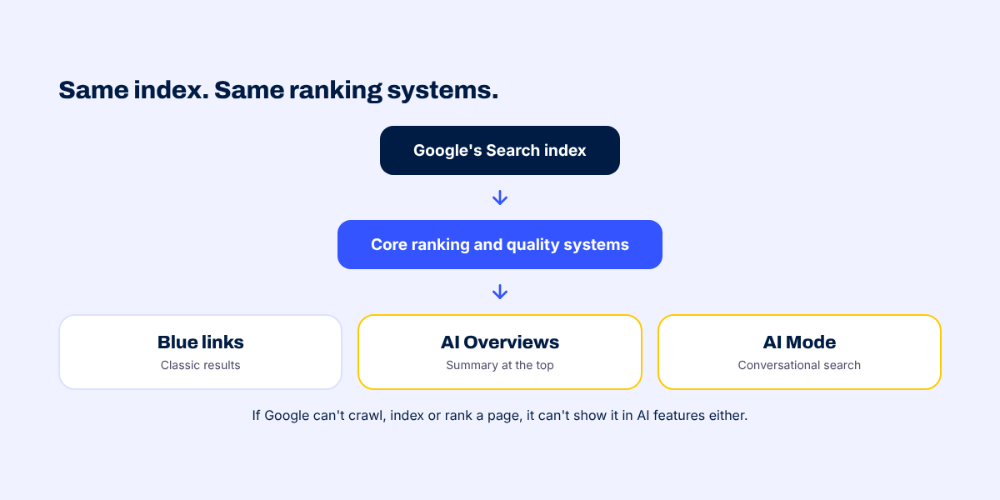
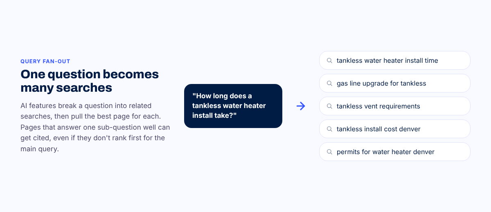
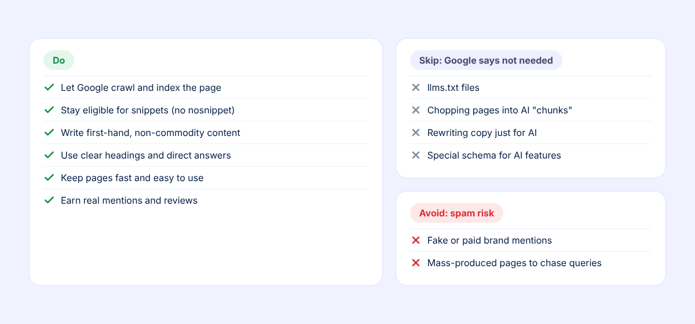
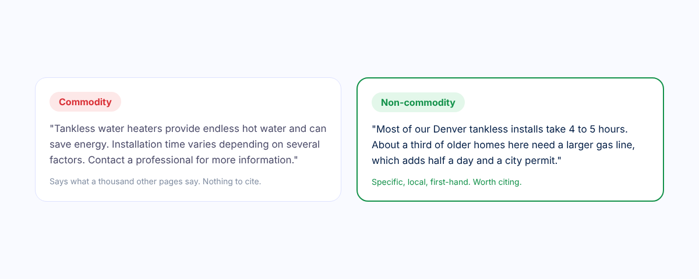

To show up in Google's AI Overviews and AI Mode, focus on strong SEO: Google confirmed that both use its regular search index and ranking systems, so a page that can't rank can't be cited. Pages that give first-hand, specific answers to the questions behind a search have the best chance of being cited.

For two years, SEOs argued about what it takes to appear in AI Overviews, and new acronyms appeared every month: AEO, GEO, LLMO. Then, on **May 15, 2026**, Google settled most of the debate with its first official guide to optimizing for generative AI features in Search.

The guide also clears up what you can stop worrying about, and what can get you in trouble. Here's what it means for a small business website, with a made-up example: Northgate Plumbing in Denver.

## AI Overviews and AI Mode use the same system as regular Search

This is the most important point in Google's guide. AI Overviews and AI Mode don't have their own separate index. They pull from the same Search index and rely on the same core ranking and quality systems as the blue links.

That has a simple consequence. If Google can't crawl your page, can't index it, or doesn't rank it as a strong answer, it won't cite it in an AI feature either. There are no extra technical requirements beyond what regular Search needs, and no way to submit a page to AI Overviews.

So the first job is the same as always: make sure your important pages are crawlable, indexed and eligible to show a snippet. If you haven't checked those in a while, start with my [technical SEO audit checklist](/blog/technical-seo-audit-checklist/).

> **Quick check:** If you use a `nosnippet` tag or `max-snippet:0` on a page, Google can't quote it in a regular snippet or an AI feature. Remove those from any page you want cited.

## How AI features pick sources: query fan-out

Google describes a process called **query fan-out**. When someone asks a question, AI Overviews and AI Mode break it into several related searches, run them, and pull the best pages for each part of the answer.

Say someone asks, "How long does a tankless water heater install take?" Behind the scenes, Google might also search for gas line upgrades, venting rules, install costs in Denver and permit requirements. A page that answers one of those sub-questions really well can get cited, even if it doesn't rank first for the main question.

This is why AI features often show a wider mix of sources than the top ten results. For you, it means covering the questions around your service, not just the main keyword. A strong service page plus a few focused posts on related questions gives Google more ways to use you. My guide to [building topical authority](/blog/how-to-build-topical-authority/) shows how to plan that.

## What Google says to do

Most of the guide's advice is familiar, but it's worth seeing it in one place:

- **Let Google crawl and index the page.** No blocks in robots.txt, no stray `noindex` tags.
- **Stay eligible for snippets.** AI features quote and summarize, so pages need to allow it.
- **Write content people find useful.** Google uses the phrase "non-commodity" content: something a generative system couldn't easily reproduce from what's already out there.
- **Make the page easy to use.** Clear headings, direct answers, fast loading and good mobile experience still matter.
- **Earn your reputation honestly.** Google's AI features can reflect what's said about businesses across blogs, videos and forums, and its ranking and spam systems still decide what gets surfaced.

## What Google says you can skip

This is where the guide saves you time and money. For Google's AI features, it says you don't need:

- **llms.txt files.** Google's systems don't use them for AI Overviews or AI Mode.
- **Chopping content into small "chunks."** Google handles long pages with several topics without special formatting.
- **Rewriting your content just for AI.** Google understands natural phrasing and synonyms.
- **Special structured data for AI.** Schema still helps for rich results, but there's no AI-specific markup.

If someone is selling you an "AI Overview optimization" package built on these, ask what it does that regular SEO doesn't.

One caveat: this guide only covers Google. ChatGPT, Perplexity and Claude work differently in some ways. For those, see [how to get your business recommended by ChatGPT](/blog/how-to-get-your-business-recommended-by-chatgpt/).

## What to avoid: tactics that can hurt you

The guide is clear that Google's existing spam policies apply to AI features too. Two are worth calling out:

- **Inauthentic mentions.** Paying for or planting fake brand mentions on other sites to influence AI answers is a quality violation. It can backfire.
- **Mass-produced pages.** Generating hundreds of thin pages to cover every possible question falls under Google's scaled content abuse policy, however the pages are made.

## What "non-commodity" content looks like

This is the part that separates the businesses that get cited from the ones that don't. Commodity content says what everyone else says. Non-commodity content adds something only you can add.

For a local business, non-commodity content usually comes from:

- **Your own numbers.** Real price ranges, job times, and how often a certain problem comes up in your area.
- **Local knowledge.** Permits, climate, building types, regulations that apply where you work.
- **Your experience.** What you've seen go wrong, what you'd recommend, and why.
- **Original photos and examples.** From your own jobs, with permission.

You don't need to write more. You need to write what only you can write. An AI system can summarize the general advice from a dozen sites. It can't invent your install times in Denver.

## How to measure your AI Overview visibility

Google added a **Generative AI performance report** to Search Console in June 2026, and it's now on every property. It shows how often your pages appeared in AI Overviews and AI Mode, broken down by page, country, device and date.

A few things to know:

- It shows **impressions only**. Clicks from AI features are counted in your main Performance report.
- It doesn't show the queries or prompts that triggered your appearance.
- In Google Analytics, clicks from AI Overviews and AI Mode show up as Organic Search, not as AI traffic.

Use the report to spot which pages Google trusts enough to cite, then strengthen those and the pages around them. I cover the full setup in [how to track AI search traffic](/blog/how-to-track-ai-search-traffic/).

## The takeaway

Showing up in AI Overviews isn't a separate project. It's what happens when your site is crawlable, your pages answer real questions with real expertise, and your reputation holds up across the web. Skip the shortcuts Google says it doesn't use, avoid the ones it calls spam, and put the time into content only your business could write.

If you'd like help finding which of your pages Google already cites and where the gaps are, my [AI search visibility service](/services/ai-search-visibility/) covers it, or you can [book a free call](/contact/).
