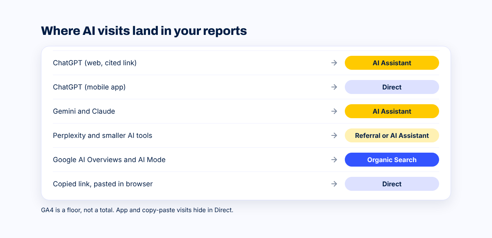
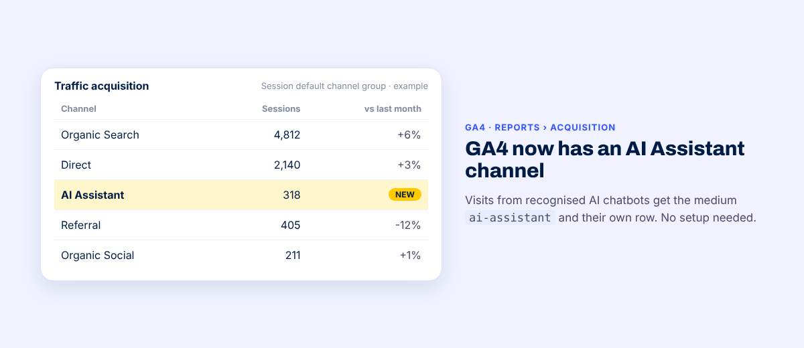
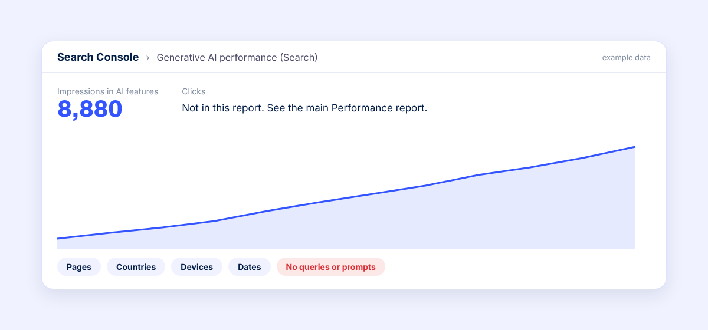
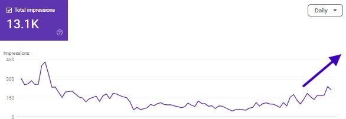
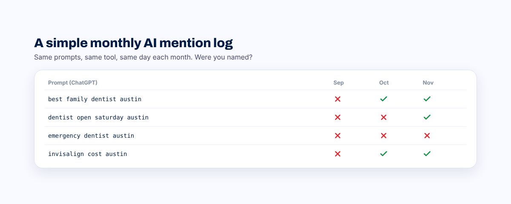

To track AI search traffic, check the AI Assistant channel in GA4 for visits from chatbots like ChatGPT and Gemini, and the Generative AI performance report in Search Console for impressions in AI Overviews and AI Mode. Neither tool shows everything, so add tagged links and a monthly AI mention log to fill the gaps.

"Are we getting any traffic from ChatGPT?" It's one of the most common questions in SEO right now. Until 2026, the honest answer was "probably, but it's hard to tell." Then Google Analytics added its AI channel in May, and Search Console added its AI report in June. Here's how to set them up and how to read them together.

## Where AI traffic shows up (and where it hides)

Different AI tools send visits in different ways, so they land in different places in your reports.



- **ChatGPT on the web:** Usually passes a referrer, and ChatGPT adds `utm_source=chatgpt.com` to many links it cites. GA4 can identify these visits.
- **ChatGPT mobile app:** Often sends no referrer, so visits fall into **Direct**.
- **Gemini, Claude and other chatbots:** Recognised assistants go to the new AI Assistant channel. Smaller tools may still show as Referral.
- **Google AI Overviews and AI Mode:** These count as **Organic Search**. GA4 can't separate them from regular Google clicks.
- **Copied and pasted links:** No referrer, so they land in Direct.

Keep this in mind whenever you read the numbers. GA4 shows you a floor, not a total.

## Step 1: Check GA4's AI Assistant channel

On May 13, 2026, Google added an **AI Assistant** channel to GA4's default channel group. You don't need to set anything up. When GA4 recognises a visit from an AI chatbot like ChatGPT, Gemini or Claude, it sets the medium to `ai-assistant` and reports the visit under the AI Assistant channel.



No GA4 on your site yet? It's free and takes six steps. Here's [how to set up Google Analytics 4](/blog/how-to-set-up-google-analytics-4/).

To find it:

1. Open GA4 and go to **Reports › Acquisition › Traffic acquisition**.
2. Make sure the table uses **Session default channel group**.
3. Look for the **AI Assistant** row.

Then click through to see which landing pages those visitors arrive on. Those pages are the ones AI tools trust enough to link. They're usually your best candidates to strengthen further.

> **Tip:** Add a secondary dimension of **Session source** to see which assistant sent each visit. Keep an eye on **Referral** too, for AI tools GA4 doesn't recognise yet.

If you built a custom AI channel group with a regex before May 2026, don't delete it straight away. Compare the two for a month first, so you know what each one catches.

## Step 2: Track AI Overviews and AI Mode in Search Console

Google's AI features don't show up as AI traffic in GA4, so you need Search Console for those. In June 2026, Google launched the **Generative AI performance report**, and by August it was live on every property.



The report shows how often links to your site appeared in AI Overviews and AI Mode. You can break it down by:

- Pages
- Countries
- Devices
- Dates

What it doesn't show:

- **Clicks.** Those stay in the main Performance report, mixed with other web results.
- **Queries or prompts.** You can see which pages appeared, but not what people asked.
- **Cities or regions.** Country is the smallest location breakdown.

Use it to answer two questions. Which of my pages does Google cite in AI features? And is that number growing? Compare the cited pages with your main Performance report to see whether they also get clicks.

Here's what that second question looks like in a real report. Daily impressions dropped for a few months, then started climbing again:



Look at the trend over weeks, not single days. Daily numbers jump around, and one spike doesn't mean much on its own.

Read Google's [announcement of the report](https://developers.google.com/search/blog/2026/06/gen-ai-performance-reports) and [help page](https://support.google.com/webmasters/answer/16984139) for the full details.

## Step 3: Tag the links you control

Some AI-related links are yours to tag. For example:

- The website link on your **Google Business Profile**
- Links in your profiles on directories that AI tools often cite
- Links you share in community posts or newsletters

Add UTM parameters to these so you can tell them apart in GA4. A simple pattern:

```text
https://www.yoursite.com/?utm_source=google&utm_medium=organic&utm_campaign=gbp
```

This won't track AI traffic directly. But it stops visits from your profiles from blending into everything else, which makes the AI numbers easier to read.

## Step 4: Keep a monthly AI mention log

Analytics only counts people who click. Many people read an AI answer, see your name, and call you or search for you directly later. To capture that, track whether you're **mentioned**, not just whether you get clicks.



Here's the routine I use:

1. Pick 10 to 20 prompts your customers would really ask, like "best family dentist in Austin" or "emergency dentist open Sunday Austin."
2. On the same day each month, ask each one in ChatGPT, Perplexity and Gemini, in a fresh chat.
3. Record whether you were named, which competitors were named, and which sources were cited.

A spreadsheet is fine. Paid tools can automate this across hundreds of prompts, but for a local business, a manual log of 20 prompts tells you most of what you need. If you're not being named yet, start with [how to get your business recommended by ChatGPT](/blog/how-to-get-your-business-recommended-by-chatgpt/).

## Step 5: Ask new customers how they found you

It sounds old-fashioned, but it works. Add "ChatGPT or another AI tool" as an option on your booking form's "How did you hear about us?" question, and have your front desk ask on the phone. It's the only way to count people who found you through AI and then called directly.

## How to read the numbers together

Put the four sources side by side each month:

| Source | What it tells you |
|---|---|
| GA4 AI Assistant channel | Visits from AI chatbots you can identify |
| Search Console Generative AI report | How often Google's AI features show your pages |
| AI mention log | Whether AI tools name you, and who they name instead |
| "How did you hear about us?" | Customers who found you through AI and called directly |

None of them is complete on its own. Together, they show whether your AI visibility is growing and which pages and sources are driving it.

## What good looks like for a local business

Don't expect AI traffic to rival Google search yet. For most local businesses, it's still a small slice of total visits. What matters is the trend and the quality. AI visitors often arrive after the assistant has already recommended you, so they're further along in deciding. Check their conversion rate in GA4, not just their numbers.

If you want help setting this up, it's part of my [AI search visibility service](/services/ai-search-visibility/). Or [book a free call](/contact/) and we'll look at your GA4 and Search Console together.
