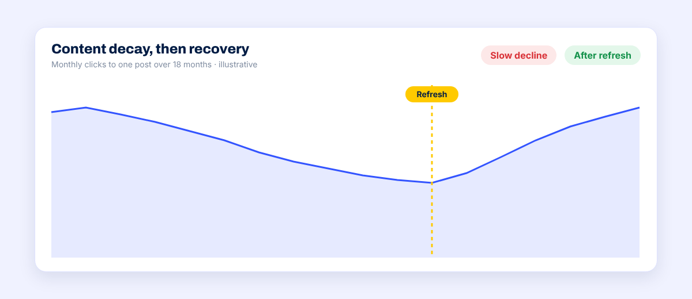
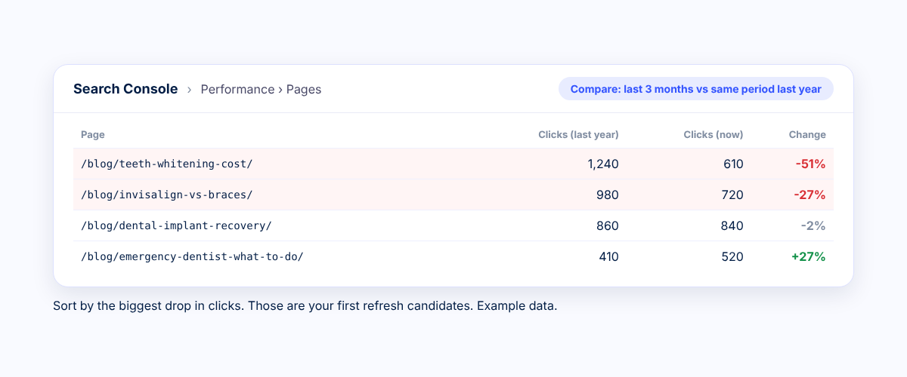
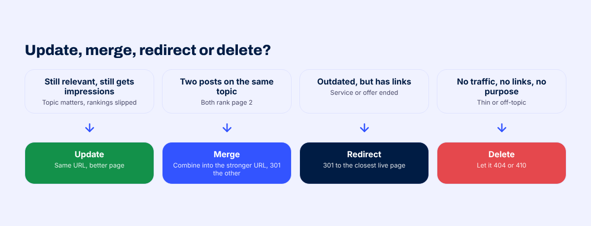
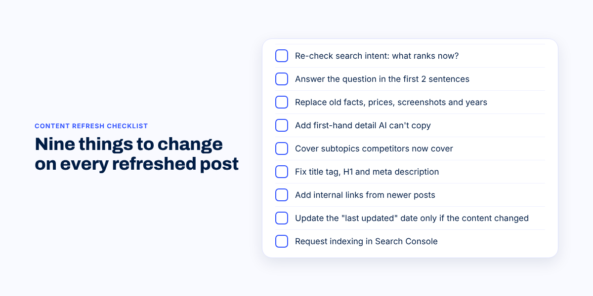

To update an old blog post for SEO, find the pages losing clicks in Search Console, check what ranks for the keyword now, and refresh the substance with new facts, first-hand detail and better answers. Changing only the date doesn't work.

You wrote a post two years ago. It ranked well and brought in steady traffic. Now it's slipping, a little more every month. Competitors published better answers, your facts went out of date, and AI Overviews now answer part of the question at the top of the page. This slow slide is called **content decay**, and it happens to nearly every blog.

The fix is usually not to write something new. Here's how to find the posts worth saving, decide what to do with each, and update them so they rank again.

## What content decay looks like

Decay is rarely a sudden drop. It's a slow decline over months, which is why it's easy to miss.

Common causes:

- **Outdated information.** Prices, laws, statistics, screenshots and years that are no longer right.
- **Better competitors.** Someone published a more complete or more useful answer.
- **Changed search intent.** People searching the keyword now want something different, like a comparison instead of a definition.
- **AI Overviews.** Google now answers the simple part of the question at the top, so your post needs to offer what the summary can't.
- **Weaker internal links.** Newer posts took over your homepage and menus, and the old post got buried.

## Step 1: Find your decaying posts in Search Console

Open Google Search Console and go to **Performance › Search results**. Then:

1. Click the date filter and choose **Compare**.
2. Compare the **last 3 months** with the **same 3 months last year**. This avoids seasonal swings.
3. Open the **Pages** tab.
4. Sort by the difference in clicks, from the biggest loss down.

The pages at the top lost the most traffic. Click into each one and look at its **Queries** tab, still in compare mode. You'll see exactly which searches it's losing, which tells you what to fix.

Make a short list of 5 to 10 pages to start. Prioritize the ones closest to your services: a post that brings in leads matters more than one that only gets curious readers.

## Step 2: Decide what to do with each post

Not every old post deserves a refresh. For each one, pick one of four options.

- **Update** it if the topic still matters and it still gets impressions. This is the most common choice.
- **Merge** it if you have two or more posts on the same topic that both rank on page two. Combine the best of each into the stronger URL and 301 redirect the other. Two weak pages often become one strong one.
- **Redirect** it if the post is outdated, like a service you no longer offer, but other sites link to it. Send it to the closest live page with a 301 redirect so you keep the value of those links.
- **Delete** it if it has no traffic, no links and no connection to your business. Thin, off-topic posts don't help your site, and removing them lets Google focus on the pages that matter.

## Step 3: Check what ranks for the keyword now

Before you rewrite anything, search the main keyword yourself in a private window. Look at:

- **What's in the AI Overview.** That's the basic answer Google already gives. Your post needs to go further.
- **What the top three pages do.** Are they guides, comparisons, checklists, cost breakdowns? Do they cover subtopics you don't?
- **The People also ask box.** These are questions your updated post should answer.

If the top results are now a different kind of page than yours, the search intent has changed. A definition post won't win a keyword where everyone now wants a price comparison. Adjust the format, not just the facts.

## Step 4: Refresh the content properly

Here's what to change. Aim to make the page clearly better than both your old version and the current top results.

1. **Answer the main question in the first two sentences.** Readers and AI tools both look for the direct answer first.
2. **Replace anything out of date:** prices, laws, statistics, screenshots, tool names and years.
3. **Add first-hand detail** that an AI summary can't copy: your own numbers, examples, photos and recommendations. This is what earns clicks when an AI Overview sits above you. I explain why in [how to show up in Google AI Overviews](/blog/how-to-show-up-in-google-ai-overviews/).
4. **Cover the subtopics** the top pages cover and you don't, plus the People also ask questions.
5. **Cut what no longer helps.** Long intros, repeated points and outdated sections make the page harder to read.
6. **Fix the title tag, H1 and meta description** so they match what people search today. My guide to [writing title tags](/blog/how-to-write-title-tags-that-rank/) covers this step by step.
7. **Add internal links** to the post from newer, related posts and from your service pages. This tells Google the page still matters.
8. **Update the date honestly.** Keep the original publish date and add a "last updated" date, but only if you made real changes.
9. **Request indexing** in Search Console so Google sees the new version sooner.

> **Pro tip:** Don't change the URL unless the old one is misleading, such as one with an old year in it. If you must change it, set up a 301 redirect from the old address.

## Step 5: Measure the result

Give each refreshed post four to eight weeks, then check it in Search Console:

- **Clicks and impressions** compared with the weeks before the refresh
- **New queries** the page now shows up for
- **Average position** for the main keyword

Also check the **Generative AI performance report** in Search Console to see if the page starts appearing in AI Overviews or AI Mode. If a post doesn't move after two months, look again at search intent. It's often the format, not the facts, that needs to change.

## Build a refresh routine

Content refresh works best as a habit, not a one-off project. A simple routine for a small business:

- **Every quarter:** Run the Search Console comparison and pick the three to five posts with the biggest drops.
- **Every year:** Review your top 20 posts for outdated facts, even if traffic is steady.
- **Before writing anything new:** Check whether you already have a post on the topic that you could improve or merge instead.

Refreshing a post that already has history, links and some rankings is often faster and more effective than starting from scratch. For many small business blogs, the quickest traffic gains are hiding in posts you've already written.

If you'd like help finding which of your posts are worth refreshing, that's part of my [content strategy service](/services/content-strategy/). Or [book a free call](/contact/) and we'll go through your Search Console data together.
