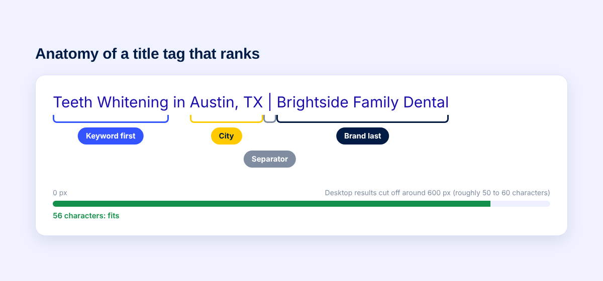
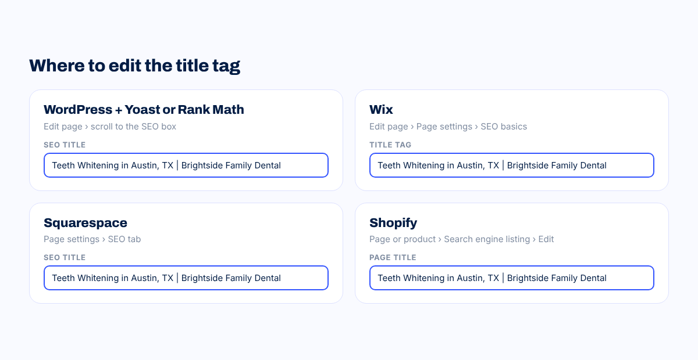
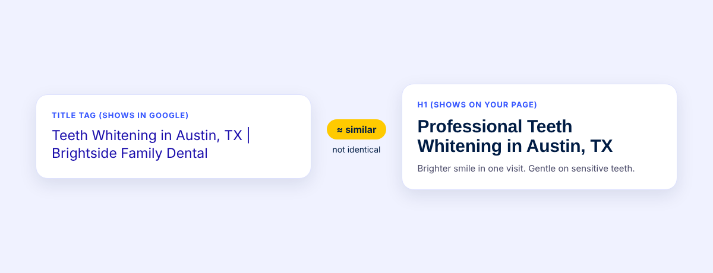
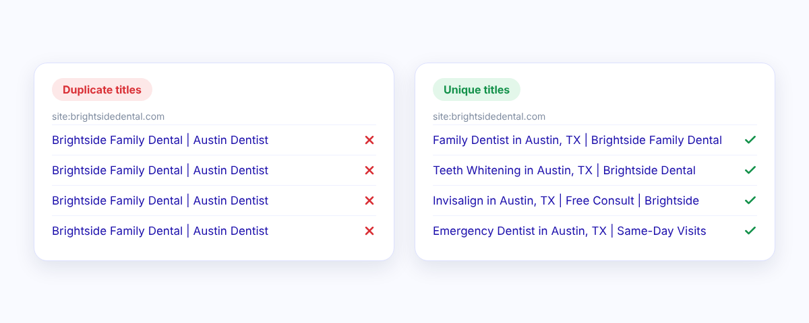
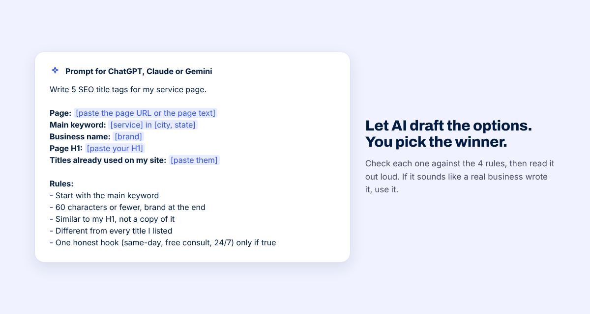

To write a title tag that ranks, put your main keyword first, then your city, and keep it under about 60 characters, like "Service in City, State | Business Name." Make it similar to your H1 but not identical, and never reuse it on another page.

If you only fix one thing on a page this week, fix the title tag. It's the blue link people see in Google, one of the strongest clues you can give Google about the page, and it decides whether searchers click you or the business above you.

Here are the four rules I use on every local business site, plus an AI prompt that writes the first draft for you. For the examples, I'll use a made-up practice in Texas: Brightside Family Dental in Austin.

## What a title tag is (and why it matters for AI too)

The title tag lives in your page's code as `<title>`. Google usually shows it as the headline of your search result. Browsers show it in the tab. When someone shares your link on social media or in a chat app, it often becomes the preview headline too.



AI search tools read it too. When ChatGPT or Google's AI Overviews pick sources for an answer, a clear title helps them understand what your page covers before they read a single paragraph. A vague title like "Services" gives them nothing to work with.

A strong local title tag follows this pattern:

**Service in City, State | Business Name**

That's it. The keyword goes first so Google and searchers see it right away. The city tells Google where you serve. Your brand goes last because people searching for a service usually don't know your name yet.

## Step 1: Find where to edit your title tag

Every website platform has a field for this. It's often hidden under an "SEO" label, so many business owners never touch it and end up with titles like "Home" or "Page 2."



- **WordPress:** Install Yoast SEO or Rank Math. Open the page, scroll to the SEO box, and edit the "SEO title."
- **Wix:** Open the page's settings and go to **SEO basics**. Edit the title tag there.
- **Squarespace:** Open **Page settings**, then the **SEO** tab.
- **Shopify:** On any page or product, scroll to **Search engine listing** and click Edit.

If your platform shows a Google preview, use it. It shows you right away if your title is too long.

## Step 2: Put your keyword first, then your city

Use the exact words people type into Google. Not the words you use internally. A dentist might say "tooth bleaching," but patients search "teeth whitening." Your title should match the patient.

Here's the difference in practice:

| Weak title | Strong title |
|---|---|
| Services \| Brightside Family Dental | Teeth Whitening in Austin, TX \| Brightside Family Dental |
| Welcome to Our Practice | Family Dentist in Austin, TX \| Brightside Family Dental |
| Invisalign | Invisalign in Austin, TX \| Free Consult \| Brightside |

Keep the title under about 60 characters. Google cuts off titles at around 600 pixels on desktop, so a long title ends with "..." and loses the end. If you need to save space, shorten the brand name before you cut the keyword or city.

> **Pro tip:** If you have room left, add one honest hook that sets you apart: *Same-Day*, *24/7*, *Free Consult* or *Open Saturdays*. Only use it if it's true. A hook that over-promises gets clicks and then loses the call.

## Step 3: Make your title tag and H1 similar, not identical

The H1 is the main headline people see on the page. Google compares it with your title tag. When they tell the same story, Google is more confident about the page's topic and more likely to keep your title as written.



They don't need to match word for word. In fact, it's better when they don't. The title tag is built for the search results, so it includes your brand. The H1 is built for the person already on your page, so it can be warmer and more specific.

- **Title tag:** Teeth Whitening in Austin, TX | Brightside Family Dental
- **H1:** Professional Teeth Whitening in Austin, TX

Same topic, same keyword, same city. Different jobs.

## Step 4: Never reuse a title tag on two pages

Duplicate titles are one of the most common problems I find in audits. They usually happen when a theme or plugin fills every title with the same site name, or when someone copies a page to build a new one.



When every page says "Brightside Family Dental | Austin Dentist," Google can't tell your whitening page from your Invisalign page. It may pick the wrong page for a search, or rewrite your titles itself.

Three ways to check your site for duplicates:

1. **Google search:** Type `site:yourdomain.com` and scan the blue links. Repeats jump out fast.
2. **Search Console:** Open the **Performance** report and look at **Pages**. If two pages get impressions for the same keyword, check their titles.
3. **Screaming Frog:** The free version crawls up to 500 URLs and has a filter for duplicate titles.

Give every page its own title that names its own service. For location pages, change the city. For blog posts, write the title around the question the post answers.

## SEO title examples for every page type

Here's how the same rules play out across a whole site. Each example follows the same SEO title best practices: keyword first, city where it helps, under 60 characters, and one title per page.

| Page | Example title tag | Why it works |
|---|---|---|
| Homepage | Family Dentist in Austin, TX \| Brightside Family Dental | Names the main service and city, not just "Home" |
| Service page | Dental Implants in Austin, TX \| Brightside Family Dental | One service per page, keyword first |
| Location page | Dentist in Round Rock, TX \| Brightside Family Dental | Only the city changes, so no two titles match |
| Blog post | How Long Does Teeth Whitening Last? A Dentist Explains | Uses the exact question people search |
| About page | About Our Austin Dentists \| Brightside Family Dental | Adds the city so the page still means something in Google |
| Contact page | Contact Brightside Family Dental \| Austin, TX | Brand first is fine here, since people search it by name |

Use these as patterns, not templates. Swap in the words your own customers type, which you can find in the **Queries** tab of Search Console.

## Let AI write the first draft

This is where AI tools earn their keep. ChatGPT, Claude or Gemini can give you five solid options in seconds, as long as you give them the right context and rules.



Copy this prompt and fill in the brackets:

```text
Write 5 SEO title tags for my service page.

Page: [paste the page URL or the page text]
Main keyword: [service] in [city, state]
Business name: [brand]
Page H1: [paste your H1]
Titles already used on my site: [paste them]

Rules:
- Start with the main keyword
- 60 characters or fewer, brand at the end
- Similar to my H1, not a copy of it
- Different from every title I listed
- One honest hook (same-day, free consult, 24/7) only if true
```

Then do the human part. Check each option against the four steps above. Count the characters. Read it out loud. Pick the one that sounds like a real business wrote it, not a robot trying to rank.

## Common title tag mistakes to avoid

- **Keyword stuffing.** "Dentist Austin | Austin Dentist | Best Dentist in Austin TX" looks spammy to people and to Google. Say it once.
- **Brand first on service pages.** "Brightside Family Dental | Teeth Whitening" buries the keyword. Lead with what people search.
- **ALL CAPS or emojis.** They rarely help clicks, and Google often removes them.
- **Changing titles every week.** Give a new title four to six weeks before you judge it. Rankings need time to settle.
- **Forgetting the homepage.** Your homepage title should name your main service and city, not just "Home."

## How to check if your new title is working

After you update a title, go to Google Search Console and use **URL Inspection** on the page. Click **Request Indexing** so Google picks up the change sooner.

Then wait a month and open the **Performance** report. Filter by that page and compare clicks and click-through rate with the month before. A better title often lifts clicks before rankings move, because more people choose your result from the same spot.

Title tags are step three in my [on-page SEO checklist](/blog/on-page-seo-checklist-google-ai/). If you want someone to rewrite them across your whole site, my [technical SEO service](/services/technical-seo/) includes title and H1 cleanup for every page, or you can [book a free call](/contact/) and we'll go through your top pages together.
