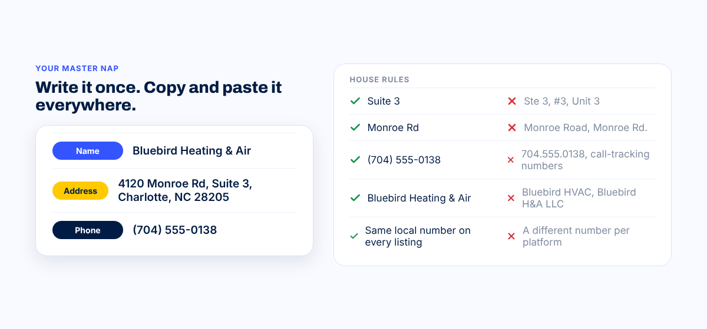
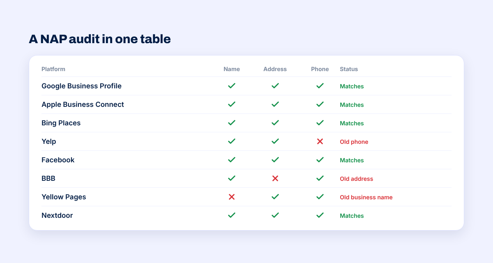
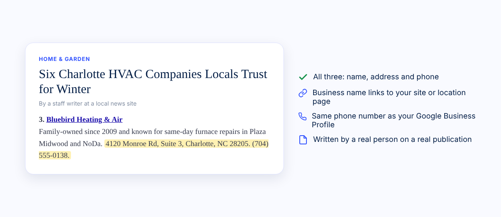
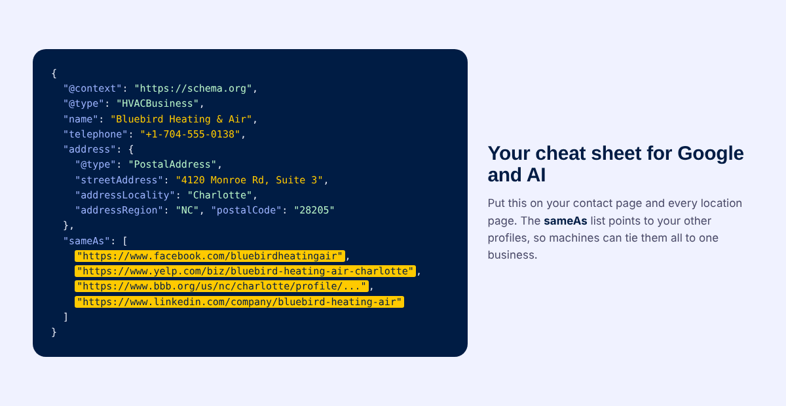
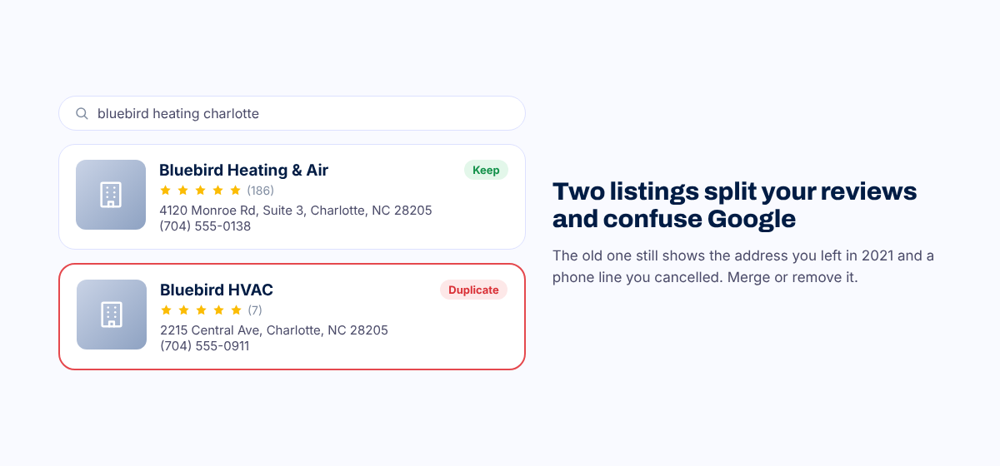

**NAP consistency** means your business name, address and phone number appear exactly the same everywhere your business is listed online: your website, your Google Business Profile, directories, social media and local articles. When the details match, Google and AI tools trust them, and you show up more often in the map pack and in AI answers.

Here's a problem I see on almost every local SEO audit. The business is listed as "Bluebird Heating & Air" on Google, "Bluebird HVAC" on Yelp, and "Bluebird H&A LLC" on the BBB. The address says "Suite 3" in one place and "#3" in another. Facebook still shows the phone number they dropped three years ago.

None of that looks serious on its own. Together, it makes Google and AI tools less sure who you are and where you are. And when a search engine isn't sure, it shows someone else.

This guide covers what NAP consistency is, why it still matters, and a four-step playbook to fix it. I'll use a made-up HVAC company in Charlotte, North Carolina, to show what each step looks like.

## What is NAP consistency, and why does it matter?

NAP stands for **name, address and phone number**. Some people add a W for website, which is a good habit too.

Google builds its picture of your business from many sources. Your Google Business Profile is the main one. Then it cross-checks your website, directories, social profiles, news articles and map data. When those sources agree, Google trusts the details and feels safe showing you in the local map pack.

AI search works the same way, only more so. When someone asks ChatGPT or Perplexity for "a good HVAC company in Charlotte," the tool pulls facts from across the web. If your details conflict, the AI may skip you, mix you up with another business, or give out an old phone number. Consistent NAP is how you make sure it gets you right.

**NAP in Google Business Profile optimization.** If you've heard NAP in the context of GMB or GBP optimization, it means the name, address and phone on your Google Business Profile. That profile is the version Google trusts most, so it becomes your master copy. Every other listing should match it exactly.

## NAP consistency example: what a mismatch looks like

Here's the made-up HVAC company from above, with its listings side by side:

| Where | Name | Address | Phone |
|---|---|---|---|
| Google Business Profile (master) | Bluebird Heating & Air | 4120 Park Rd, Suite 3, Charlotte, NC 28209 | (704) 555-0138 |
| Yelp | Bluebird HVAC ❌ | 4120 Park Rd, Suite 3, Charlotte, NC 28209 | (704) 555-0138 |
| BBB | Bluebird H&A LLC ❌ | 4120 Park Road #3, Charlotte, NC 28209 ❌ | (704) 555-0138 |
| Facebook | Bluebird Heating & Air | 4120 Park Rd, Suite 3, Charlotte, NC 28209 | (704) 555-0192 ❌ |

Each ❌ is a small conflict. Together, they give Google four slightly different businesses to choose from.

**A real example from my own work.** A junk removal client's website said "junk removal" while its Google Business Profile said "debris removal." Google had no clean signal for what the business did. We picked one term and matched it across the website, the profile and every directory listing, alongside a few other profile fixes. In the first 30 days, searches that found the business rose 75%. You can read the full [junk removal case study](/results/junk-removal-google-business-profile/).

## Start with your master NAP

Before you touch a single listing, decide exactly how your details should look. Write it down once. Then copy and paste it everywhere. Never retype it.

Settle these details up front:

- **Name:** Use your real business name, the one on your signage. Don't add keywords or cities that aren't part of the legal or trading name. Google treats keyword stuffing in names as spam.
- **Address:** Pick one format and stick to it. "Rd" or "Road." "Suite 3" or "#3." Use the format from your Google Business Profile, since that's the version Google already trusts.
- **Phone:** Use one local number, written the same way each time. A local area code helps more than a toll-free number for local search.
- **Website:** Pick one version, like `https://www.yoursite.com/`, and use it everywhere.

Save this in a shared note so anyone who creates a listing for you uses the exact same text.

## Step 1: Fix the big platforms first

You don't need 300 directory listings. You need the ones that matter to be correct. Start with the platforms Google, Apple and AI tools pull from most.

**For US businesses, start here:**

1. Google Business Profile
2. Apple Business Connect (feeds Apple Maps and Siri)
3. Bing Places for Business (Bing's data also feeds several AI search tools)
4. Yelp
5. Facebook
6. Better Business Bureau
7. Nextdoor
8. Industry sites, like Angi for home services, Avvo for lawyers, or Healthgrades and Zocdoc for clinics

**For Australia,** add Yellow Pages, True Local and Hotfrog. **For Singapore,** add Yellow Pages Singapore and Streetdirectory.

Log in to each one, claim it if you haven't, and paste in your master NAP. Add your hours, categories and website while you're there. Keep a simple spreadsheet with the platform, the login, and the date you checked it. You'll thank yourself later.

## Step 2: Get mentioned in real local articles

Directories prove you exist. Real articles prove people talk about you. Both Google and AI tools give extra weight to mentions in genuine editorial content, like a local news roundup or a "best of" list written by a real person.

When you get a mention, three things make it count for more:

- **All three details.** A name alone is a weak signal. Name plus address plus phone ties the mention to your exact business and location.
- **A link.** Ask for your business name to link to your website or, for multi-location businesses, the specific location page.
- **The same phone number as your Google Business Profile.** This is where call tracking numbers cause trouble. If the article lists a different number, it doesn't connect as cleanly.

Where do these mentions come from? Sponsoring a local team or event. Answering a reporter's question on a site like Featured or Qwoted. Getting included in a local "best of" list by reaching out to the writer. Joining your chamber of commerce. Each one takes effort, which is exactly why they carry weight.

## Step 3: Add schema markup to your contact and location pages

Your website is the one listing you fully control. Schema markup lets you state your NAP in a format search engines and AI tools read directly, without guessing.

Add `LocalBusiness` schema, or a specific type like `HVACBusiness`, `Dentist` or `LegalService`, to your contact page and every location page. Include:

- Your name, address and phone, copied from your master NAP
- Your hours and website
- A `sameAs` list with links to your Facebook, Yelp, BBB, LinkedIn and other profiles

That `sameAs` list is the part most people skip. It tells machines that all those profiles belong to the same business. Think of it as a cheat sheet that connects the dots for Google and AI.

Test your code with Google's [Rich Results Test](https://search.google.com/test/rich-results) before you publish. And make sure the same NAP also appears as plain text on the page, usually in the footer. Schema should confirm what visitors can see, not replace it.

## Step 4: Check your NAP consistency and clean up duplicate listings

This is the step that usually makes the biggest difference, because it fixes problems you didn't know you had. Old addresses from a move. A second listing someone created by accident. A former name from before a rebrand.

**How to check NAP consistency for free:**

1. Search Google and Google Maps for your business name, your old name, and your phone number in quotes, like `"704-555-0138"`.
2. Search your old addresses too.
3. For a faster first pass, ask an AI tool with web search to find every listing it can for your business and put it in a table with the name, address and phone each one shows. Use the result as a starting point, then check each listing yourself. AI tools miss some listings and sometimes report details wrong.
4. For a quick automated check, Moz offers a free listing check. For a deeper scan, NAP consistency checkers like BrightLocal and Whitespark check hundreds of directories at once. BrightLocal has a 14-day free trial.

**How to fix them:**

- **Duplicate Google listings:** If you own both, contact Google Business Profile support and ask them to merge or remove the duplicate. If you don't own it, open the listing in Maps, choose **Suggest an edit**, and report it as a duplicate.
- **Old details on directories:** Claim the listing and update it. If you can't claim it, most platforms have a support form for corrections.
- **Data aggregators:** In the US, many small directories copy data from aggregators like Data Axle and Foursquare. Fixing your record there stops old details from spreading again.

A duplicate listing does more harm than you'd think. It splits your reviews across two profiles, and it can push the weaker one into the map results instead of your real one.

## What about call tracking numbers?

Call tracking is useful. You should know which marketing brings in calls. The trick is to use it without breaking your NAP.

On Google Business Profile, put the tracking number as the **primary phone** and your real local number as an **additional phone**. That keeps your main number tied to the listing. On directories and in articles, use your main number. Use tracking numbers on ads and landing pages where you control the context, not on listings Google uses to verify you.

## When your business moves or rebrands

A move or a new name is the moment NAP problems are born. Plan it like a project:

1. Update your Google Business Profile first. Expect Google to ask you to verify the new address.
2. Update your website footer, contact page and schema the same day.
3. Work through your spreadsheet of platforms and update each one.
4. Ask sites that mentioned you to update the article, especially high-traffic ones.
5. Keep your old phone number if you can. It's the detail that ties your history to your new location.

If you're thinking about moving or opening a new location, check the local rankings at the new address before you commit. I walk through that in [how to check the map before you sign a lease](/blog/check-local-seo-before-new-business-location/).

## Your NAP checklist

- Write one master NAP and save it where your team can find it.
- Claim and update the major platforms for your market.
- Earn mentions in real local articles with all three details and a link.
- Add LocalBusiness schema with `sameAs` links to your contact and location pages.
- Search for duplicates and old details every six months.

NAP work isn't glamorous, but it's one of the most dependable fixes in local SEO. It also sets up everything else, from reviews to [AI search visibility](/services/ai-search-visibility/). If you'd like me to run a NAP audit for your business, it's part of my [local SEO service](/services/local-seo/), or you can [book a free call](/contact/) to talk it through.
