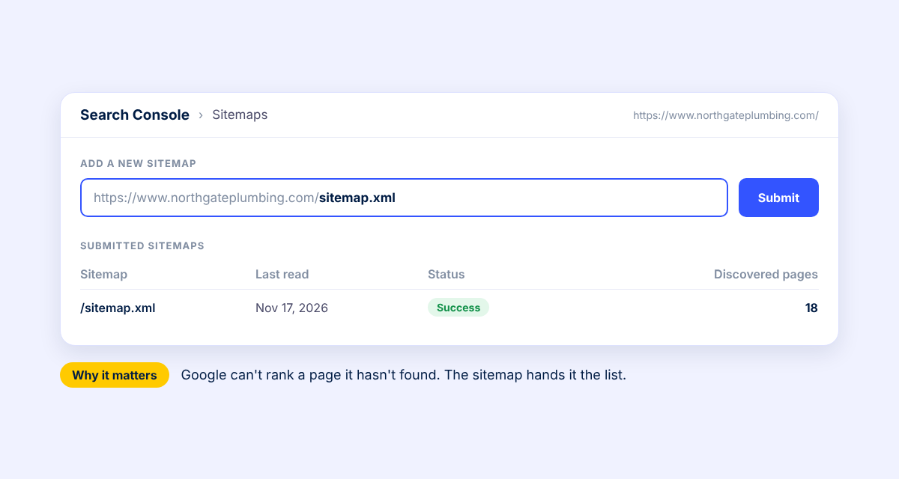
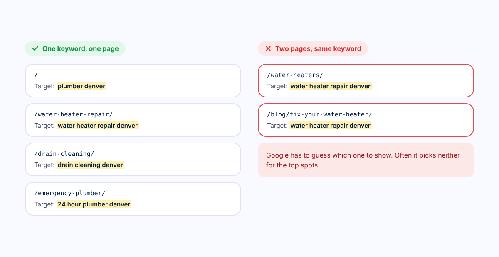
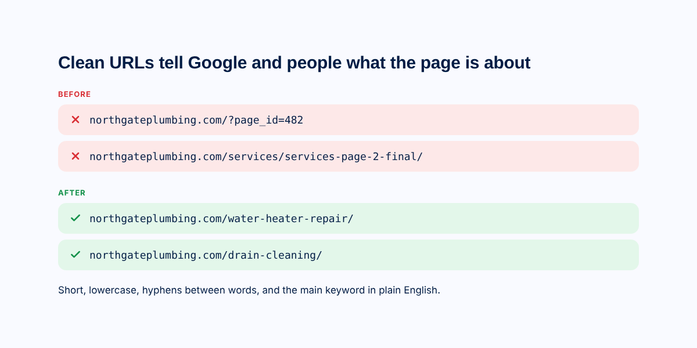
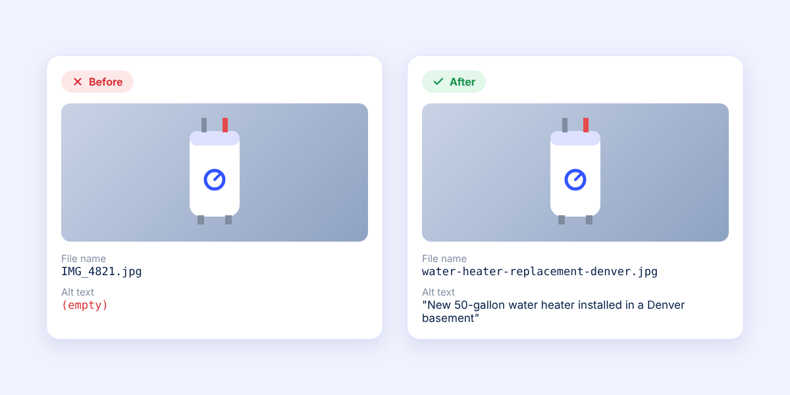
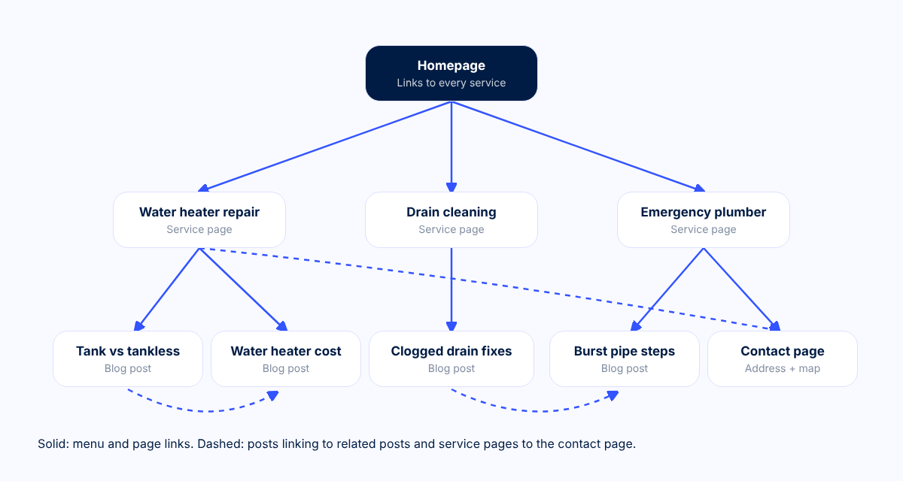
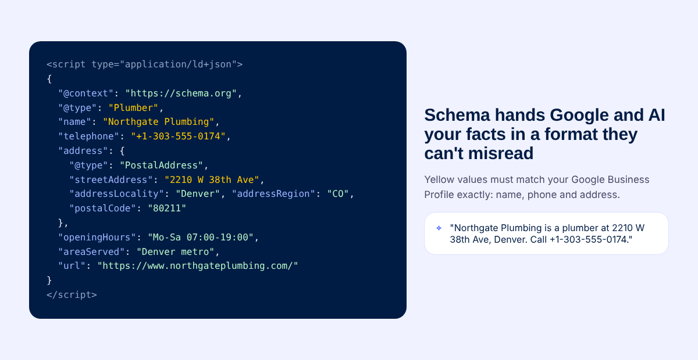

The nine on-page SEO basics are: set up Search Console, pick one keyword per page, then optimize your title tag, URL, meta description, images, H1, internal links and schema. Do them in that order, and your pages become easy for Google to rank and for AI tools like ChatGPT to recommend.

If your website looks good but nobody finds it on Google, and ChatGPT names your competitors instead, it almost always comes down to these basics. They're the nine I check first on every site I audit, and each step builds on the one before.

I'll use a made-up plumbing company in Denver, Northgate Plumbing, so you can see what each fix looks like on a real-world site.

## 1. Set up Google Search Console and submit your sitemap

Start here, because nothing else matters until Google knows your pages exist. [Google Search Console](https://search.google.com/search-console) is free. It shows you which pages Google has indexed, which searches you show up for, and what's broken.

Here's the quick version:

1. Add your site as a **Domain property** and verify it through your domain's DNS. Your registrar or host usually has a one-click option.
2. Find your sitemap. On WordPress with Yoast it's `/sitemap_index.xml`. Wix, Squarespace and Shopify use `/sitemap.xml`.
3. Go to **Sitemaps**, paste the address, and click Submit.
4. Come back in a few days. Check **Pages** to see how many are indexed and why any aren't.

That last step catches big problems early. A stray `noindex` tag or a blocked folder can hide your whole site, and Search Console is where it shows up first. For every verification option and the fixes for common errors, follow my guide on [how to set up Google Search Console step by step](/blog/how-to-set-up-google-search-console/).

## 2. Pick one main keyword for each page

Every page should have one job. Your water heater page targets "water heater repair denver." Your drain page targets "drain cleaning denver." Your homepage targets the broad term, like "plumber denver."

When two pages chase the same keyword, Google has to guess which one to show. This is called keyword cannibalization, and it often means neither page reaches the top spots.

To pick the right keyword, think like your customer. What would they type into Google right before they call you? Use free tools like Google's autocomplete and the "People also ask" box to see the exact wording. Write the keyword down next to each page in a simple spreadsheet. That sheet becomes your map for the next six steps.

## 3. Put the keyword in your title tag

The title tag is the blue link people see in Google. It's one of the strongest clues you can give Google about a page, and it's also your first chance to win the click.

A good local title tag follows a simple pattern: **Service in City, State | Business Name**. For example: *Water Heater Repair in Denver, CO | Northgate Plumbing*.

Keep it under about 60 characters so it doesn't get cut off. Start with the keyword, end with your brand, and make every page's title unique. I break this down step by step, with an AI prompt you can copy, in [how to write a title tag that ranks](/blog/how-to-write-title-tags-that-rank/).

## 4. Clean up the URL

Your URL should read like a label, not a filing code. Google uses words in the URL as a small ranking hint, and people are more likely to click a link they understand.

Good URLs are short, lowercase, use hyphens between words, and include the main keyword. Drop dates, filler words and numbers that mean nothing.

One warning: if a page already ranks or has links pointing to it, don't change its URL casually. Set up a **301 redirect** from the old address to the new one. Otherwise you throw away the trust that page already earned.

## 5. Write a meta description that earns the click

The meta description is the short text under your title in Google. It doesn't directly change rankings, but it changes how many people click. More clicks from the same position means more calls.

Write it like a mini ad, between 140 and 160 characters:

- Say what you do and where.
- Give one reason to pick you, like same-day service, free estimates or a guarantee.
- End with an action: call, book or get a quote.

*Example: "Fast water heater repair in Denver. Same-day service, upfront pricing, licensed plumbers. Call Northgate Plumbing for a free quote today."*

Google rewrites descriptions sometimes, especially when your text doesn't match the search. A clear, specific description gets kept more often.

## 6. Name your images and add alt text

Photos help you rank in Google Images, which is a real source of local traffic. They also give Google and AI tools another clue about what the page covers. Most sites waste this by uploading files straight from a phone.

Before you upload, rename the file to describe the photo, with hyphens between words. Then add **alt text**: one plain sentence describing what's in the image. Alt text exists for people using screen readers, so write it for them first. If the keyword fits naturally, great. If it doesn't, leave it out.

While you're at it, compress large images. Big photos slow your page down, and slow pages lose visitors on mobile.

## 7. Use one H1 per page

The H1 is the main headline on the page. Google and AI tools read it to confirm what the page is about, so every page needs exactly one.

Your H1 should match the title tag closely without copying it word for word. If the title is *Water Heater Repair in Denver, CO | Northgate Plumbing*, the H1 could be *Fast Water Heater Repair in Denver*.

Under the H1, use H2s for your main sections and H3s for points inside them. Think of it as a table of contents. Many site themes use H1 tags for the logo or a slider headline. Check your pages with a free browser extension like Detailed SEO or SEO Meta in 1 Click, and fix any page that shows zero or several H1s.

## 8. Link your pages together

Internal links are links from one page on your site to another. They help Google find every page, and they show which pages matter most. They also keep visitors moving toward a call or a booking.

A simple structure works for most local businesses:

- Your homepage links to every main service page.
- Each service page links to related blog posts and to your contact page.
- Each blog post links back to the service it supports.

Use descriptive anchor text, like "water heater repair in Denver," instead of "click here." And check for orphan pages, meaning pages no other page links to. Google often ignores them.

## 9. Add schema markup with your business details

Schema markup is a small block of code that spells out your business facts for search engines: your name, type of business, address, phone, hours and service area. People don't see it, but Google and AI tools do.

This is the step that matters most for AI search. When ChatGPT, Perplexity or Google's AI Overviews describe a local business, they need facts they can trust. Schema hands them those facts in a format they can't misread.

Add `LocalBusiness` schema, or a more specific type like `Plumber` or `Dentist`, to your homepage and contact page. Make sure the name, address and phone match your Google Business Profile exactly. If you need help writing it, I cover the full setup in [NAP consistency for local SEO](/blog/nap-consistency-local-seo/). Test your code with Google's [Rich Results Test](https://search.google.com/test/rich-results) before you publish.

> **Pro tip:** Don't add schema for things that aren't on the page. Marking up reviews or FAQs that visitors can't see breaks Google's guidelines and can cost you rich results.

## How these nine steps help you show up in AI answers

AI search tools don't use a secret ranking system. They read the same web pages Google does. Then they pick sources that are easy to understand and that agree with what other sites say about you.

That's why this checklist works for both. A clear title and H1 tell AI what the page covers. Direct answers near the top give it something to quote. Schema and consistent business details let it state your name, location and phone with confidence. If you want to go further, my [AI search visibility service](/services/ai-search-visibility/) covers entity building and citations in depth.

## What to do after you finish the checklist

Once all nine steps are done, go back to Search Console. Use **URL Inspection** on your most important pages and click **Request Indexing**. Then give it four to six weeks and check the **Performance** report for new searches and clicks.

On-page SEO is the foundation, not the whole house. Reviews, a strong Google Business Profile and mentions from other local sites build on top of it. But without these nine basics, those efforts have nothing solid to stand on.

If you'd rather have someone check your site against this list for you, [book a free strategy call](/contact/). I'll tell you which of the nine steps will make the biggest difference first.
