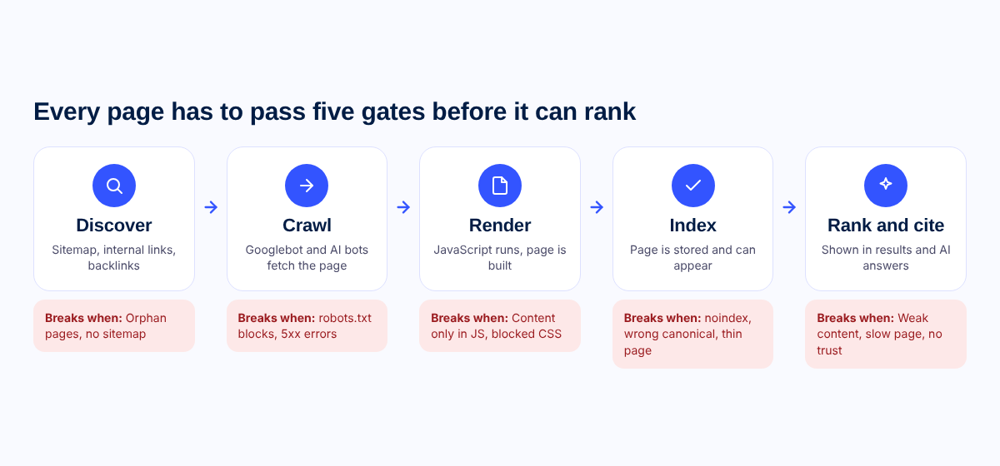
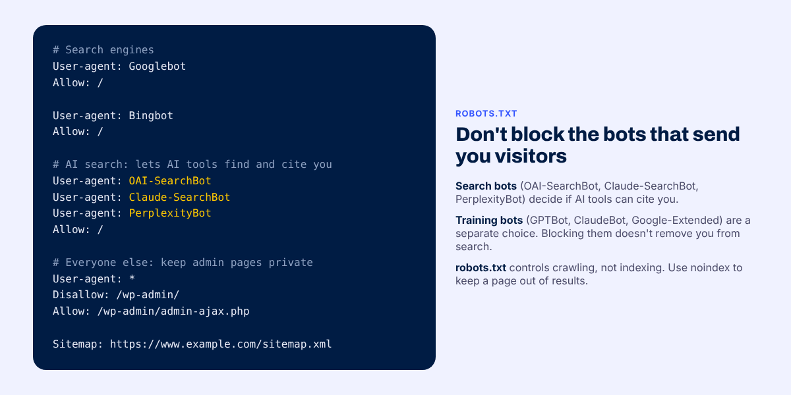
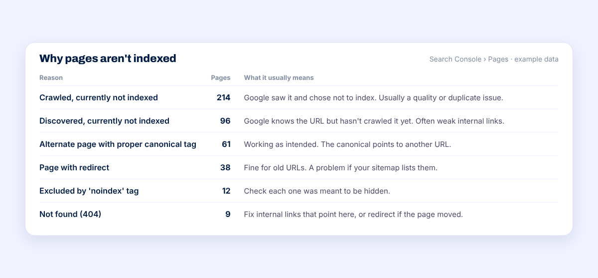
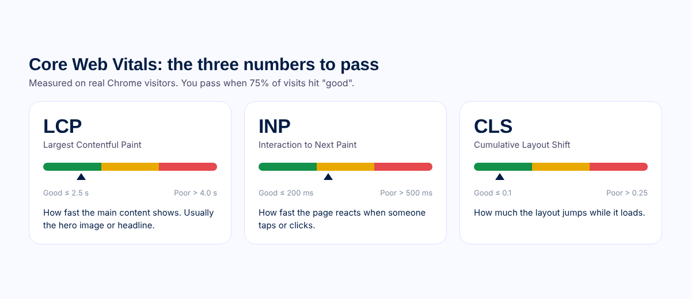
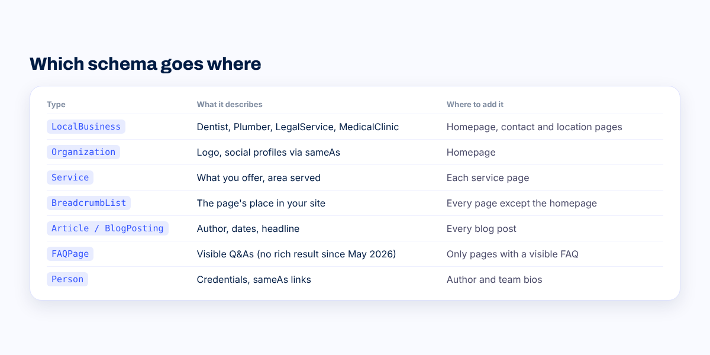
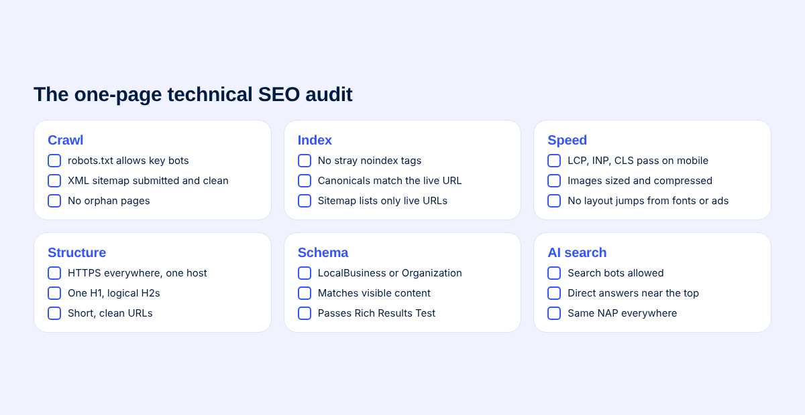

A technical SEO audit answers one question: can search engines and AI tools reach your pages, understand them, and trust them enough to show them? If the answer is no, your content, reviews and links can't do their job.

This checklist covers the five areas I audit on every site: crawlability, indexing, Core Web Vitals, structured data and AI search visibility. You'll get what to check, which tool to use, and what a fix looks like. Work through it in order. Each area depends on the one before it.

## How Google and AI tools process your website

Before a page can rank or get cited in an AI answer, it has to pass through five stages. A problem at any stage stops everything after it.

1. **Discover.** Google finds the URL through your sitemap, internal links or links from other sites.
2. **Crawl.** Googlebot, or an AI crawler, downloads the page.
3. **Render.** The crawler runs your JavaScript and builds the page as a visitor would see it.
4. **Index.** Google decides whether to store the page and which URL to file it under.
5. **Rank and cite.** The page competes for searches, and AI tools decide whether to use it as a source.

That's why I audit in this order. There's no point speeding up a page that Google can't index.

## 1. Crawlability: can bots reach your pages?

### Check robots.txt

Open `yourdomain.com/robots.txt` in your browser. It tells bots which parts of your site they can crawl. One wrong line here can hide your whole site.

Look for:

- **A stray `Disallow: /`** under `User-agent: *`. This blocks everything and is often left over from a staging site.
- **Blocked CSS or JavaScript folders.** Google needs these to render your page properly.
- **Your sitemap address** on the last line, so every bot can find it.
- **AI crawler rules.** I cover these in the AI search section below.

Remember that robots.txt controls crawling, not indexing. A blocked page can still show up in Google if other sites link to it. To keep a page out of results, use a `noindex` tag instead, and don't block it in robots.txt, or Google will never see the tag.

### Check your XML sitemap

Your sitemap should list every page you want indexed, and nothing else. Submit it in Search Console under **Sitemaps** and check that the status says Success.

A clean sitemap contains only URLs that return a 200 status, aren't blocked, have no `noindex` tag, and are their own canonical. Redirects, 404s and duplicate URLs in your sitemap send mixed signals. Most SEO plugins build the sitemap for you, but they still list pages you've forgotten about, like thank-you pages and tag archives.

### Find orphan pages and broken links

An orphan page has no internal links pointing to it. Google may never find it, or treat it as unimportant. Crawl your site with a tool like Screaming Frog, then compare the crawl with your sitemap. Any URL in the sitemap but not in the crawl is an orphan.

While the crawler runs, also check for:

- **Broken internal links (404s).** Update the link or redirect the old URL.
- **Redirect chains.** A link that hops through two or three redirects wastes crawl time. Point links at the final URL.
- **Server errors (5xx).** If these show up often, talk to your host. Repeated errors make Google crawl less.

### Check JavaScript rendering

If your site relies on JavaScript to load its main content, Google can usually render it, but not always quickly. Many AI crawlers don't run JavaScript at all. They read the raw HTML.

To test it, right-click your page and choose **View page source**. If your main text, headings and links aren't in the source, they're being added by JavaScript. For important pages, ask your developer about server-side rendering or static generation so the content is in the HTML from the start.

## 2. Indexing: is Google storing the right pages?

### Read the Page indexing report

In Search Console, open **Indexing › Pages**. This is the most useful report in any audit. It lists every page Google knows about and why some aren't indexed.

Not every reason is a problem. "Alternate page with proper canonical tag" usually means things are working. "Page with redirect" is fine for old URLs. Focus on these:

- **Crawled, currently not indexed.** Google read the page and decided not to keep it. This is usually about quality or duplication. Improve the content, merge it with a similar page, or link to it from stronger pages.
- **Discovered, currently not indexed.** Google knows the URL but hasn't crawled it. Often a sign of weak internal linking, or a large site with too many low-value URLs.
- **Excluded by 'noindex' tag.** Check every one. The most common mistake I see is a `noindex` left on from a staging or pre-launch setup.
- **Duplicate, Google chose different canonical than user.** Google disagrees with your canonical tag. Read the next section.

For step-by-step fixes for each of these, plus robots.txt and XML sitemap errors, see [how to fix "crawled, currently not indexed"](/blog/how-to-fix-crawled-currently-not-indexed/).

### Check your canonical tags

A canonical tag tells Google which URL is the main version of a page. Every indexable page should have one that points to itself, using the exact live URL.

Check for these mismatches:

- **HTTP vs HTTPS** or **www vs non-www.** Pick one version and redirect the others to it.
- **Trailing slash vs no trailing slash.** `/services` and `/services/` are different URLs to Google. Your canonical, sitemap, menus and internal links should all use the same one.
- **A canonical that points to a redirect, a 404 or a noindexed page.** Google ignores these and picks its own canonical.

A trailing slash mismatch is easy to miss and surprisingly common on WordPress. I walk through a real example in [canonical tag points to a redirect: how to fix the trailing slash issue](/blog/canonical-tag-points-to-redirect-trailing-slash/).

### Use URL Inspection on key pages

For your homepage and top service pages, paste each URL into the **URL Inspection** bar in Search Console. Check that the page is indexed, that the **user-declared canonical** matches the **Google-selected canonical**, and that the crawled page looks right. If you've just fixed something, click **Request Indexing**.

## 3. Core Web Vitals: is your site fast and stable?

Core Web Vitals are Google's three measures of page experience. They're based on real Chrome visitors, not lab tests, and you pass when at least 75% of visits score "good."

| Metric | What it measures | Good | Poor |
|---|---|---|---|
| **LCP** (Largest Contentful Paint) | How fast the main content appears | 2.5 s or less | Over 4.0 s |
| **INP** (Interaction to Next Paint) | How fast the page reacts to taps and clicks | 200 ms or less | Over 500 ms |
| **CLS** (Cumulative Layout Shift) | How much the layout jumps while loading | 0.1 or less | Over 0.25 |

Check them in two places. The **Core Web Vitals** report in Search Console groups your pages by status using real visitor data. **PageSpeed Insights** shows field data for a single URL, plus a lab test that explains what's slowing it down. Always judge by field data. Lab scores are for diagnosing, not grading.

**Common fixes by metric:**

- **Slow LCP:** Compress and resize your hero image, serve it as WebP or AVIF, and don't lazy-load it. Use a good host and a CDN. Remove sliders on the top of the page.
- **Slow INP:** Cut heavy third-party scripts like chat widgets, extra tracking tags and page builders' animation libraries. Delay scripts that aren't needed right away.
- **High CLS:** Set width and height on every image and video. Reserve space for ads, embeds and cookie banners. Load web fonts in a way that doesn't shift text.

Mobile matters most. Google indexes the mobile version of your site, and most local searches happen on phones. Test on mobile first.

For a full walkthrough, including how to read the LCP breakdown and find the scripts slowing INP, see [how to fix Core Web Vitals](/blog/how-to-fix-core-web-vitals/).

## 4. Structured data: does Google understand your business?

Structured data, also called schema markup, is code that describes your page in a format machines read directly. It can earn rich results, like breadcrumbs, product details and event listings, and it helps Google connect your pages to a real business.

For most local and service businesses, start with:

- **LocalBusiness**, or a specific type like `Dentist`, `LegalService` or `MedicalClinic`, on your homepage, contact page and location pages.
- **Organization** with your logo and `sameAs` links to your social and directory profiles.
- **BreadcrumbList** on every page below the homepage.
- **Article** or **BlogPosting** on blog posts, with the author and dates.
- **FAQPage** only where the questions and answers are visible on the page. Google stopped showing FAQ rich results on May 7, 2026, so this won't add dropdowns to your listing, but the markup is harmless to keep.

Two things schema won't do: Google doesn't show review stars when a business marks up reviews about itself with LocalBusiness or Organization schema, and Google says there's no special schema needed for AI Overviews or AI Mode.

Three rules keep schema working for you:

1. **Only mark up what's on the page.** Schema for hidden reviews or FAQs breaks Google's guidelines.
2. **Match your business details everywhere.** The name, address and phone in your schema should match your Google Business Profile exactly. My [NAP consistency playbook](/blog/nap-consistency-local-seo/) covers this step by step.
3. **Test before and after publishing.** Use Google's [Rich Results Test](https://search.google.com/test/rich-results) for eligibility and the [Schema Markup Validator](https://validator.schema.org/) for syntax. Then watch the **Enhancements** reports in Search Console.

If your site runs two SEO plugins, check that only one outputs schema. Two plugins often produce duplicate or conflicting markup, along with duplicate titles and canonicals.

For copy-ready JSON-LD examples and where to paste them on WordPress, Wix, Squarespace and Shopify, see [how to add schema markup](/blog/how-to-add-schema-markup-json-ld/).

## 5. AI search visibility: can AI tools find and cite you?

AI search tools like ChatGPT search, Perplexity, Claude and Google's AI Overviews don't use a secret system. They rely on crawling, indexing and clear content, just like search engines. A site that passes the first four sections is already most of the way there. These checks close the gap.

### Allow AI search crawlers

AI companies run different bots for different jobs. **Search bots** fetch pages so the AI can cite them in answers. **Training bots** collect data to train models. They're separate choices.

| Company | Search and citation bot | Training bot |
|---|---|---|
| OpenAI | OAI-SearchBot | GPTBot |
| Anthropic | Claude-SearchBot | ClaudeBot |
| Perplexity | PerplexityBot | (no separate bot) |
| Google | Googlebot (AI Overviews use Search) | Google-Extended (a token, not a crawler) |

If you want AI tools to recommend you, allow the search bots. Blocking training bots is up to you, and it doesn't remove you from AI search. Also check your CDN or firewall settings. Some security tools block AI crawlers by default, even when robots.txt allows them.

To confirm AI bots can reach you, check your server or CDN logs for their user agents, like OAI-SearchBot and PerplexityBot. Cloudflare shows AI crawler activity in its dashboard. If they never appear, or show blocked requests, something is stopping them.

### Don't block snippets on pages you want cited

Google's AI features quote and summarize pages, so a page with a `nosnippet` tag or `max-snippet:0` can't be used. Check your SEO plugin hasn't added these to important pages.

### Make content easy to quote

AI tools pull short, direct answers. Pages that bury the answer under long intros get skipped. For every important page:

- Answer the main question in the first two or three sentences.
- Use headings phrased the way people ask questions.
- Keep facts specific: prices, service areas, hours, credentials.
- Show who wrote the content and why they're qualified to write it.

### Keep your business facts consistent

AI tools cross-check facts across the web before they state them. If your website, Google Business Profile and directories disagree on your name, address or phone, the AI is less likely to mention you at all. Consistent details plus schema with `sameAs` links give it the confidence to name you.

### Add Bing Webmaster Tools

Bing's index feeds several AI products, so it's worth more attention than its search share suggests. Verify your site in [Bing Webmaster Tools](https://www.bing.com/webmasters), submit your sitemap, and consider **IndexNow**, a protocol that tells Bing and other engines about new and updated pages right away. Many SEO plugins and CDNs support it with one setting.

### What about llms.txt?

An `llms.txt` file is a proposed standard: a plain text summary of your site for AI tools. Google's May 2026 guide to its AI features lists llms.txt among the things site owners don't need, and no other major AI search engine has confirmed it uses the file for citations. It's harmless to have, but treat it as optional. Fixing crawling, indexing and content will do far more.

To go deeper on AI search, read [how to show up in Google AI Overviews](/blog/how-to-show-up-in-google-ai-overviews/), [how to get your business recommended by ChatGPT](/blog/how-to-get-your-business-recommended-by-chatgpt/) and [how to track AI search traffic](/blog/how-to-track-ai-search-traffic/).

## The 10 most common technical SEO issues

These are the problems I find most often when I audit small business websites. If you're short on time, check these first.

1. **A `noindex` tag left on after launch.** Often from a staging setting or a pre-launch option in the theme or SEO plugin. It can hide the whole site.
2. **Pages stuck on "Crawled, currently not indexed."** Usually thin, duplicate or poorly linked pages. [Here's how to fix it](/blog/how-to-fix-crawled-currently-not-indexed/).
3. **Canonical tags that don't match the live URL.** A trailing slash, the wrong host, or a canonical pointing at a redirect. [Example and fix](/blog/canonical-tag-points-to-redirect-trailing-slash/).
4. **Multiple versions of the site.** HTTP and HTTPS, or www and non-www, both loading without redirects.
5. **A messy XML sitemap.** Listing redirects, 404s, noindexed pages or tag archives.
6. **A slow hero image.** The most common cause of failing LCP. [How to fix Core Web Vitals](/blog/how-to-fix-core-web-vitals/).
7. **Too many third-party scripts.** Chat widgets, tag managers and page-builder add-ons that slow INP.
8. **Duplicate or missing title tags and H1s.** Every page should have its own. [How to write title tags](/blog/how-to-write-title-tags-that-rank/).
9. **Broken internal links and orphan pages.** Pages Google can't reach, or links that lead to 404s.
10. **Missing or conflicting schema.** No LocalBusiness markup, or two plugins outputting different business details. [How to add schema markup](/blog/how-to-add-schema-markup-json-ld/).

## The complete technical SEO audit checklist

Here's every check on one page. Save it and run through it twice a year, or after any redesign, migration or big plugin change.

**Crawl**
- robots.txt allows Googlebot, Bingbot and AI search bots, and lists your sitemap
- XML sitemap submitted, with only live, indexable, canonical URLs
- No orphan pages, broken internal links or redirect chains
- Main content is in the HTML source, not only added by JavaScript

**Index**
- Page indexing report reviewed, with every `noindex` page checked
- Canonical tags point to the exact live URL on every indexable page
- One version of the site: HTTPS, one host, one trailing slash style
- User-declared and Google-selected canonicals match on key pages

**Speed**
- LCP, INP and CLS pass in field data, on mobile first
- Images resized, compressed and served in modern formats
- Third-party scripts trimmed or delayed

**Structure**
- HTTPS on every page, with no mixed content warnings
- One H1 per page and a logical heading order
- Short, readable URLs and a clear internal linking structure

**Schema**
- LocalBusiness or Organization schema with matching business details
- Breadcrumbs and articles marked up, and FAQ markup only for visible questions
- No errors in the Rich Results Test or Search Console

**AI search**
- AI search bots allowed in robots.txt and not blocked by your firewall
- Direct answers near the top of key pages
- Same business name, address and phone everywhere
- Site verified in Bing Webmaster Tools

## Where to start if you're short on time

If you only have an hour, do these three things:

1. Open the **Page indexing** report in Search Console and fix any page with a `noindex` tag or a canonical problem that shouldn't have one.
2. Run your homepage and top service page through **PageSpeed Insights** and fix the biggest LCP issue, which is usually the hero image.
3. Open your **robots.txt** and make sure nothing important is blocked.

Those three catch most of the serious problems I find. After that, work through the rest of the list one section at a time. For the on-page side, like titles, headings and alt text, pair this with my [on-page SEO checklist](/blog/on-page-seo-checklist-google-ai/).

If you'd rather have an expert run the audit, my [technical SEO service](/services/technical-seo/) covers every item here, and my [AI search visibility service](/services/ai-search-visibility/) goes deeper on getting cited by AI tools. You can also [book a free call](/contact/) and we'll look at your Search Console together.
